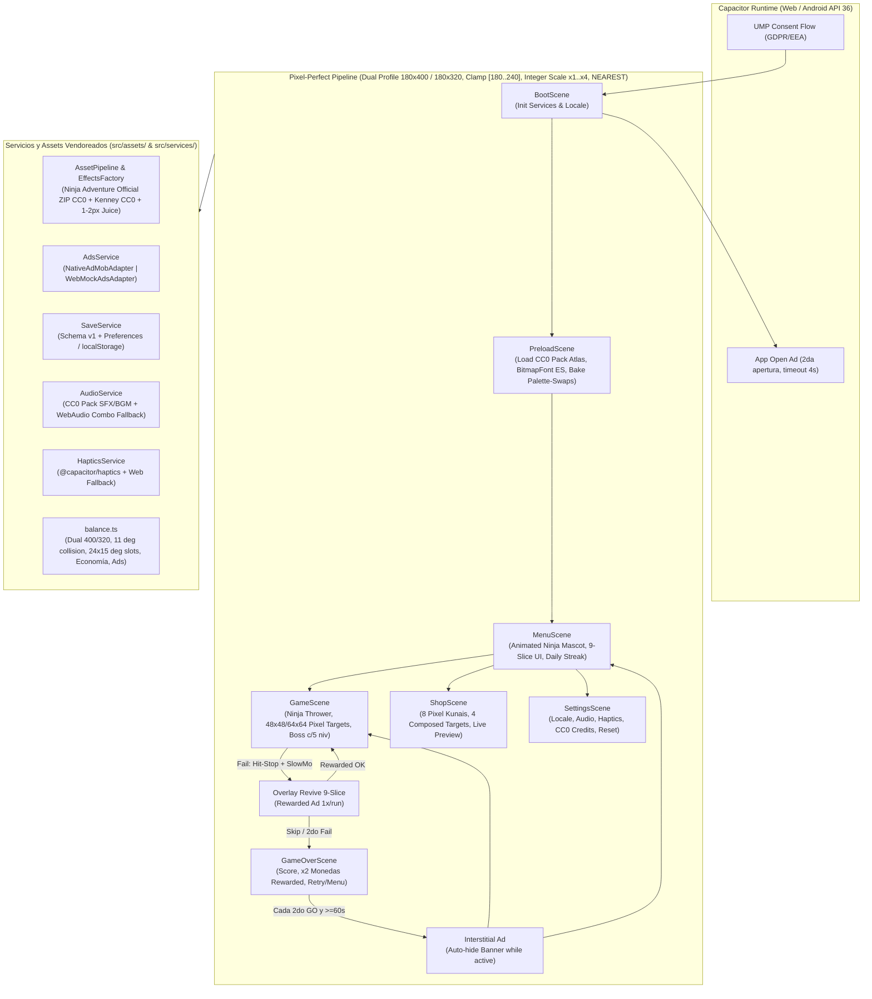

# Plan de Implementación — KUNAI RUSH (Android Hyper-Casual)

## Objetivo del Proyecto
Desarrollar **KUNAI RUSH**, un juego hyper-casual completo, pulido y listo para publicar en Google Play Store bajo temática *Ninja Nocturno*, inspirado en la mecánica de lanzamiento de precisión rotacional (estilo *Knife Hit*), construido con **Phaser 3 + TypeScript + Vite + Capacitor** y monetizado con **Google AdMob** cumpliendo estrictamente las políticas de Google Play y AdMob (incluyendo consentimiento UMP GDPR/EEA y público objetivo 13+).

El proyecto será **100% autónomo en runtime** (cero backend, cero cuentas de usuario, cero peticiones a CDNs o dependencias de assets externos en runtime) mediante **mini pixel art 16×16 real hecho a mano (packs CC0 verificados y vendoreados en `src/assets/` durante el desarrollo y empaquetados con Vite)** + **juice moderno** (tweens, partículas pixeladas, hit-stop, screen shake, parallax, viñeta/iluminación), **SFX y música CC0 del pack** (con WebAudio únicamente como complemento/fallback para pitch-up de combo y desbloqueo de `AudioContext`), y un `AdsService` dual que permite probar todos los flujos de monetización (Banner, Interstitial, Rewarded, App Open y Consentimiento UMP) directamente en el navegador mediante overlays DOM interactivos y telemetría de impresiones.

Además, el desarrollo seguirá una **estrategia de integración continua en GitHub (`kunai-rush`, repositorio público) con micro-commits y `git push` constantes** tras cada funcionalidad, servicio, escena o documento completado.

---

## (a) Investigación en GitHub, Fuentes Pixel Art CC0 y Verificación de Licencias

### 1. Fuentes Verificadas de Arte y Audio Pixel Art 16×16 (Orden de Prioridad Estricto)

> [!IMPORTANT]
> **Enmienda de Dirección de Arte — Mini Pixel Art Real 16×16:**
> Queda **PROHIBIDO** usar `Phaser.GameObjects.Graphics` o SVG para entidades visibles del juego (kunais, dianas, coleccionables, personajes, botones, paneles, iconos). Solo se permiten elementos procedurales para efectos de post-procesado/juice (partículas de 1–2 px, grano, viñeta, flashes, grading y letterbox). Ningún asset fuera de las fuentes listadas a continuación puede incluirse sin aprobación explícita.

| Prioridad | Pack / Fuente | Fuente Autoritativa / Fallback | Licencia Verificada | Contenido y Uso en KUNAI RUSH |
| :-: | :--- | :--- | :--- | :--- |
| **1. PRIMARIA** | **Ninja Adventure Asset Pack** (Pixel-Boy & AAA) | **Fuente autoritativa:** ZIP oficial de [pixel-boy.itch.io/ninja-adventure-asset-pack](https://pixel-boy.itch.io/ninja-adventure-asset-pack) (~89 MB, actualizado 2026, declaración CC0 en la página).<br>*(El espejo GitHub [pixel-boy/NinjaAdventure](https://github.com/pixel-boy/NinjaAdventure) es el proyecto Godot de 2024 sin `LICENSE` visible en raíz ni las updates 2024–2026; queda **solo como fallback**, NUNCA como prueba de licencia).* | **CC0 1.0** (Dominio Público, verificar licencia interna del ZIP + guardar copia de la declaración CC0 de la página de itch.io en `src/assets/licenses/`) | **Fuente principal del juego:** Mascota ninja animada (`idle`/`throw` en `MenuScene` y al pie de `GameScene`), kunais/shurikens base (60+ armas/items), dianas compuestas sobre rejilla 48×48 / 64×64 (tronco, piedra, farol, máscara oni), 9 bosses animados + facesets para dianas Boss, tilesets de dojo/bosque nocturno con parallax, paneles UI 9-slice, fuentes bitmap reales incluidas en el ZIP (verificando sus nombres reales al extraer), SFX (`thunk`, `coin`, `fail`, `throw`, `break`) y pista ambiental ninja nocturna. *Se vendorea únicamente el subconjunto usado para mantener el repo liviano.* |
| **2. COMPLEMENTO** | **Kenney Tiny Dungeon** | [kenney-assets.itch.io/tiny-dungeon](https://kenney-assets.itch.io/tiny-dungeon) | **CC0 1.0** (Dominio Público) | **Complemento 16×16:** 130+ sprites 16×16 (armas adicionales, cofres/monedas o detalles de diana/decoración si algún ítem específico requiere variedad extra manteniendo densidad 16×16). |
| **3. FALLBACK** | **0x72 DungeonTileset II** + **Kenney Fonts** | [0x72.itch.io/dungeontileset-ii](https://0x72.itch.io/dungeontileset-ii) / [opengameart.org/content/kenney-fonts](https://opengameart.org/content/kenney-fonts) | **CC0 1.0** (Dominio Público) | **Fallback verificado:** Tiles/armas 16×16 adicionales y fuentes pixel (`KenPixel`, `KenPixel Mini`) en caso de necesitar glifos adicionales. |

**Reglas de Vendoreo y Atribución (Tarea P0.5):**
1. Descargar el **ZIP oficial de itch.io** del *Ninja Adventure Asset Pack*, verificar el archivo de licencia interno y guardar también copia de la declaración **CC0 1.0** de la página oficial en `src/assets/licenses/` (junto con la licencia de Kenney).
2. Vendorear **únicamente el subconjunto de archivos utilizados** en `src/assets/` (< 5 MB).
3. Documentar licencias y agradecimientos en `THIRD_PARTY_LICENSES.md` e incluir una vista/modal de **Créditos** dentro de `SettingsScene` (agradecimiento a Pixel-Boy & AAA y Kenney).

### 2. Verificación de candidatos de código y mecánicas (Sección 2 del Brief)

| Repositorio | Enlace | Licencia Verificada | Calidad / Estado | Qué reutilizaremos / Decisión |
| :--- | :--- | :--- | :--- | :--- |
| **`iagodahlem/knife-hit`** (*hocho*) | [github.com/iagodahlem/knife-hit](https://github.com/iagodahlem/knife-hit) | **MIT** (© Iago Dahlem) | Excelente (Phaser 3) | **Hallazgo principal para la mecánica matemática core.** Reutilizaremos (conservando el aviso de copyright MIT en `THIRD_PARTY_LICENSES.md` y en el módulo matemático) la **fórmula trigonométrica de colisión angular** (`Phaser.Math.Angle.ShortestBetween` entre el ángulo de impacto y los ángulos de objetos clavados en el contenedor rotatorio) y la cinemática de rebote al fallar. **No se usa ninguno de sus PNGs.** |
| **`phaserjs/template-vite-ts`** | [github.com/phaserjs/template-vite-ts](https://github.com/phaserjs/template-vite-ts) | **MIT** | Excelente (Oficial) | Plantilla oficial de Phaser 3 + Vite + TypeScript. Base limpia para `tsconfig.json`, `vite.config.ts` y ciclo de vida `Boot -> Preload -> Main`. |
| **`phaserjs/examples`** | [github.com/phaserjs/examples](https://github.com/phaserjs/examples) | **MIT** (solo código fuente) | Excelente (Oficial) | **Solo patrones de código** (tweens, contenedores, partículas y `NineSlice`). No se usa ningún asset de este repo. |
| **`gabrielecirulli/2048`** | [github.com/gabrielecirulli/2048](https://github.com/gabrielecirulli/2048) | **MIT** | Muy buena | Patrón de persistencia limpia en `localStorage` con serialización segura y debounce de input. |
| **`iamkun/tower_game`** / **`GameDevHQ/Timber`** | [tower_game](https://github.com/iamkun/tower_game) / [Timber](https://github.com/GameDevHQ/Timber) | **MIT** | Buena | Referencia de curvas de dificultad progresiva por fórmula matemática y feedback visual de impacto (partículas direccionales y sacudida de cámara). |

### 3. Verificación del requisito de `targetSdk` en Google Play (`developer.android.com`)
- Según la política oficial vigente de Google Play (efectiva desde el **31 de agosto de 2026**), todas las **nuevas apps y actualizaciones** para teléfonos y tablets Android deben apuntar a **Android 16 (API level 36)** o superior (`compileSdk = 36`, `targetSdk = 36`).
- Configuraremos `variables.gradle` del proyecto Android con `compileSdkVersion = 36` y `targetSdkVersion = 36` (`minSdkVersion = 24`).

---

## Pipeline Técnico Pixel-Perfect (Obligatorio)

1. **Configuración de Phaser (`GameConfig`):**
   - `pixelArt: true`, `roundPixels: true`, `antialias: false`.
   - Filtrado `NEAREST` en todas las texturas, spritesheets, atlas y fuentes bitmap del juego.
2. **Perfil Lógico Dual (`180×400` / `180×320`), Layout Proporcional y Escalado Entero (`×1..×4`):**
   - **Perfil Alto (por defecto):** base lógica **`180×400` px** (9:20 exacto, 25 tiles de `16 px`), alto lógico `400`, ancho adaptativo con **clamp `[180, 240]`**.
   - **Perfil Corto (16:9 / gama baja con `minSdk 24`):** base lógica **`180×320` px** (20 tiles de `16 px`), alto lógico `320`, ancho adaptativo con **clamp `[180, 240]`**.
   - **Regla determinista de selección de perfil y escala entera (`×1`, `×2`, `×3`, `×4`):**
     - Si `Math.floor(altoCSS / 400) >= 2` -> usar **Perfil Alto (`400 px`)** con factor entero `Math.floor(min(anchoCSS / logicalW, altoCSS / 400))`.
     - Si `Math.floor(altoCSS / 400) < 2` -> usar **Perfil Corto (`320 px`)**; y si `Math.floor(altoCSS / 320) < 2`, permitir **`×1`** como último recurso (pantallas muy bajas), siempre con letterbox temático, **jamás crop ni escalado fraccionario**.
   - **Encajes exactos verificados:**
     - **`360×800`** (QA móvil principal 20:9): Perfil Alto `180×400` -> **`×2` EXACTO sin letterbox**.
     - **`360×640`** (QA móvil 16:9 gama baja, DPR 2/3 típico en `minSdk 24`): `floor(640/400) = 1 < 2` -> Perfil Corto `180×320` -> **`×2` EXACTO sin letterbox**.
     - **`400×800`** (capturas para Google Play Store, relación máxima **2:1**): Perfil Alto `200×400` -> **`×2` EXACTO sin letterbox**.
     - **`390×844`**: Perfil Alto `195×400` -> **`×2`** con solo `44 px` verticales de letterbox temático.
   - **Layout en fracciones del alto lógico (`logicalH`):** `GameScene`, `MenuScene`, modales y HUD posicionan todos sus elementos en **fracciones relativas de `logicalH`** (p. ej. HUD superior al ~8%, diana centrada al ~40% de `logicalH`, mascota ninja anclada al pie), **nunca en píxeles Y absolutos fijos**, de modo que tanto el perfil `400` como el perfil `320` funcionen sin solapamientos ni retoques.
   - Canvas con CSS `image-rendering: pixelated; image-rendering: crisp-edges;`. **Prohibido** el escalado fraccionario y el render a DPR alto sobre el canvas lógico.
3. **Atlas, Padding y Densidad de Texels Uniforme (16×16):**
   - Spritesheets y atlas empaquetados/procesados con **padding/extrude de `1 px`** anti-bleeding para evitar artefactos al rotar o hacer scroll de tiles.
   - Todo el arte mantiene densidad de texels 16×16 uniforme:
     - **Kunais:** sprites 16×16 / 8×16 nativos del pack. En vuelo **NO rotan** (suben verticales nítidos); al clavarse pasan al contenedor de la diana y heredan su rotación con filtrado `NEAREST`.
     - **Dianas (4 normales + 3 Boss):** compuestas sobre la rejilla nativa del pack (**`48×48` o `64×64` px nativos**: rueda de tronco con anillos, sello de piedra del dojo, farol ancestral, máscara oni; y bosses del pack para niveles múltiplos de 5). **Nunca** círculos vectoriales.
     - **Rotación Retro-Moderna:** la lógica de giro en `TargetWheel.ts` es continua en `delta` time (priorizando el *game feel* a 60 FPS), mientras el sprite compuesto rota con `NEAREST`.
4. **Skins Pre-Horneadas Píxel a Píxel (Sin Vectores):**
   - **8 Kunais:** sprite base de kunai/arma ninja del pack + **palette-swaps pre-horneados en `PreloadScene`** reemplazando colores de la paleta píxel a píxel en un `CanvasTexture` con `NEAREST` (no `setTint` multiplicativo plano ni formas vectoriales inventadas).
   - **4 Dianas:** 4 composiciones de sprites/tiles 48×48 o 64×64 distintas del pack.
5. **Mascota Ninja Animada, Fondo con Parallax, UI 9-Slice y Fuentes Bitmap Con Glifos ES:**
   - **Mascota:** personaje ninja del pack con animación `idle` y `throw` en `MenuScene` y situado al pie de `GameScene` (reproduce la animación `throw` sincronizada con cada lanzamiento de kunai y reacción en fallo/victoria).
   - **Fondo:** tileset del pack (dojo / bosque nocturno) con parallax sutil multi-capa. La paleta *"Ninja Nocturno"* se aplica al entorno, iluminación y overlays de color grading/viñeta en `EffectsFactory.ts`, respetando los colores originales de los sprites.
   - **UI y Tipografía Bitmap Pixel-Perfect:** paneles `NineSlice` (`9-slice`), marcos, iconos y botones reales del pack Ninja Adventure. Para el texto, se usarán **únicamente las fuentes realmente incluidas en el ZIP oficial del pack** (verificando sus archivos reales al extraer) o **Kenney Fonts** como fallback, renderizadas siempre vía **`Phaser.GameObjects.BitmapText` / `RetroFont`** desde un atlas de glifos con `NEAREST`. Si la fuente del pack viene en formato `.ttf`, se **pre-horneará un atlas PNG de glifos con umbral binario de alfa** (cero `fillText` con antialiasing del navegador en runtime). El atlas de glifos incluirá obligatoriamente todos los caracteres del español: **`ñ Ñ á é í ó ú ü Á É Í Ó Ú Ü ¡ ¿`**, verificados explícitamente en el Gate QA P2.

---

## Decisiones y Preflight Check Multi-PC en P0

> [!IMPORTANT]
> **Ejecución del Paso `P0.0` (Verificación Individual Antes de Instalar):**
> El **primer paso de P0 (`P0.0`)** no instalará nada a ciegas. Ejecutará un chequeo individual de cada herramienta y ruta del sistema:
> 1. **Node.js y npm (`node -v`, `npm -v`):** Si ya están instalados (Node >= 18), se usan directamente; solo se instala Node.js LTS si no existe.
> 2. **Git (`git --version`, `git config user.name`, `git config user.email`):** Si ya está instalado, se usa directamente.
> 3. **GitHub CLI (`gh --version`, `gh auth status`):** Se verifica si `gh` está instalado y con sesión activa.
> 4. **JDK (`java -version`, `javac -version`, `JAVA_HOME`) y Android SDK (`ANDROID_HOME`, `ANDROID_SDK_ROOT`):** Se comprueba si el entorno cuenta con JDK 17/21+ y Android SDK. Si están presentes, en **P4** además de preparar `android/` ejecutaremos el build Gradle de verificación; si no están presentes, se deja `npx cap add android` + `npx cap sync` 100% configurado y documentado según la Sección 9 del Brief.
> 5. **Repositorios Públicos y `app-ads.txt` en la Raíz del Dominio:**
>    - El repositorio del juego (`KUNAI-RUSH` / `kunai-rush`) servirá `privacy.html` en su subpath de GitHub Pages (`https://<usuario>.github.io/KUNAI-RUSH/privacy.html`).
>    - Dado que **AdMob exige que `app-ads.txt` viva en la raíz exacta del dominio de desarrollador** declarado en Google Play (`https://<usuario>.github.io/app-ads.txt`, donde el subpath `/KUNAI-RUSH/app-ads.txt` **no** es válido), mantendremos una copia de `app-ads.txt` en este repositorio y documentaremos/configuraremos en `PUBLISHING.md` el repositorio público adicional de GitHub Pages de usuario (`<usuario>.github.io`) con `app-ads.txt` en la raíz.

---

## Estrategia de Git y GitHub: Micro-Commits y Push Continuo

Cada vez que completemos una unidad mínima funcional (configuración, vendoreo de assets CC0, servicio, pool, escena, adaptador de anuncios o documento), ejecutaremos:
```bash
git add <archivos>
git commit -m "<tipo>(<alcance>): <descripción concisa en inglés>"
git push origin main
```

### Mapa de los 27 Micro-Commits + Push Planificados

| # | Fase | Mensaje de Commit (Conventional Commits) | Qué incluye el Commit + Push |
| :-: | :-: | :--- | :--- |
| **C01** | P0 | `chore(init): scaffold vite typescript phaser pixel-art project and gitignore` | `.gitignore` (excluyendo `keystore.properties`, `*.jks`, `node_modules`, `dist`), `package.json`, `tsconfig.json`, `vite.config.ts`, `index.html` (CSS `image-rendering: pixelated`) |
| **C02** | P0 | `feat(config): add centralized game balance and difficulty formulas` | `src/config/balance.ts` con perfil lógico dual (`180x400` por defecto / `180x320` corto cuando `floor(h/400) < 2`, clamp ancho `[180, 240]`, fallback `×1`), `minCollisionAngleDeg: 11`, geometría de `24` slots de `15°`, curvas de nivel, giro, boss, economía y cadencia de ads |
| **C03** | P0 | `feat(config): add pixel-art skins catalog, admob test ids and es/en i18n dictionary` | `src/config/skins.ts` (paletas píxel a píxel de 8 kunais y recetas de 4 dianas + 3 bosses del pack), `src/config/adsConfig.ts`, `src/config/i18n.ts` |
| **C04** | P0 | `feat(save): implement versioned SaveService with preferences and localStorage fallback` | `src/services/SaveService.ts` (schema v1, migración, racha diaria, inventario, contadores de ads) |
| **C05a** | P0.5 | `feat(assets): vendor CC0 pixel-art packs with licenses and atlas pipeline` | Descarga desde el **ZIP oficial de itch.io de Ninja Adventure (CC0)** + **Kenney Tiny Dungeon / Fonts (CC0)** en `src/assets/` (`sprites/`, `ui/`, `tiles/`, `fonts/`, `audio/`, `licenses/` con licencia interna y declaración CC0 de la página), atlas bitmap con glifos ES (`ñ á é í ó ú ü ¡ ¿`), extrude 1 px y `THIRD_PARTY_LICENSES.md` |
| **C05b** | P1 | `feat(art): implement AssetPipeline with 1px padding, palette-swap baking and EffectsFactory` | `src/objects/AssetPipeline.ts` (carga de atlas/spritesheets `NEAREST`, BitmapFont atlas con umbral de alfa sin antialiasing, palette-swaps píxel a píxel de 8 kunais, composición de 4 dianas y 3 bosses en 48×48/64×64) y `src/objects/EffectsFactory.ts` (solo partículas 1–2 px, grano, viñeta, flashes, grading y letterbox) |
| **C06** | P1 | `feat(scenes): implement BootScene, PreloadScene and 9-slice pixel UITheme` | `src/scenes/BootScene.ts`, `src/scenes/PreloadScene.ts`, `src/ui/UITheme.ts` (selector determinista de perfil `400`/`320` y escala entera `×1..×4` con letterbox temático, helpers de layout en fracciones del alto lógico, paneles 9-slice, botones pixelados y `BitmapText` con glifos ES) |
| **C07** | P1 | `feat(gameplay): implement TargetWheel with composed pixel targets and delta-time rotation` | `src/objects/TargetWheel.ts` (dianas 48×48/64×64 del pack rotando con `NEAREST`, patrones nv 1–4 constante, 5+ aceleración, 10+ inversión, 15+ sinusoidal con destello ámbar telegrafiado) |
| **C08** | P1 | `feat(gameplay): implement KunaiPool and CollectiblePool with angular collision and 24-slot validator` | `src/objects/KunaiPool.ts` (kunais verticales en vuelo, rotación heredada al clavar, colisión runtime a `minCollisionAngleDeg = 11°`), `src/objects/CollectiblePool.ts` (items 16×16 del pack) + validador de viabilidad por `24` slots de `15°` (`freeSlots >= kunaisToThrow`) |
| **C09** | P1 | `feat(gameplay): implement core GameScene loop with animated ninja mascot and 3-phase boss` | `src/scenes/GameScene.ts` (layout proporcional en fracciones de `logicalH`: HUD arriba, diana ~40%, mascota ninja `idle`/`throw` al pie; fondo dojo/bosque con parallax, impacto, rebote en fallo, Boss cada 5 niveles con sprites de boss del pack, debounce y pausa por foco) |
| **C10** | P1 | `feat(scenes): add MenuScene with animated ninja mascot and GameOverScene flow` | `src/scenes/MenuScene.ts`, `src/scenes/GameOverScene.ts`, `src/main.ts` (MVP pixel-perfect con layout proporcional + Gate QA Visual P1 en `360×800`, `360×640` y `390×844`) |
| **C11** | P2 | `feat(juice): add pooled 1-2px pixel particles, target squash, hit-stop slow-mo and combo popups` | `src/objects/ParticleManager.ts` (partículas pixeladas de 1–2 px y VFX del pack) + integración de hit-stop, slow-mo 0.4s, screen shake y flash de nivel en `GameScene.ts` |
| **C12** | P2 | `feat(audio): implement AudioService using CC0 pack SFX/music with WebAudio combo fallback` | `src/services/AudioService.ts` (carga de SFX CC0 del pack: `throw`, `thunk`, `crack`, `clang`, `coin`, `boss` + pista ambiental nocturna CC0, fallback WebAudio para pitch-up de combo y unlock en primer tap, mute persistente) |
| **C13** | P2 | `feat(haptics): implement HapticsService wrapper for capacitor haptics with web fallback` | `src/services/HapticsService.ts` + disparo al clavar/fallar/romper diana |
| **C14** | P2 | `feat(meta): add daily login streak reward system and 9-slice pixel modal` | `src/ui/DailyStreakModal.ts` (días 1–4+: +10/+15/+25/+40 monedas con UI 9-slice e iconos del pack) |
| **C15** | P2 | `feat(shop): implement ShopScene with live rotating pixel preview for 8 kunais and 4 targets` | `src/scenes/ShopScene.ts` (compra, equipamiento persistente, preview en vivo con sprites reales/palette-swaps, botón +25 monedas con cooldown 3m) |
| **C16** | P2 | `feat(settings): implement SettingsScene with CC0 credits modal, locale switch, toggles and safe reset` | `src/scenes/SettingsScene.ts` (incluye modal de **Créditos CC0** agradeciendo a Pixel-Boy & AAA y Kenney, confirmación para borrar progreso, panel QA + Gate QA Visual P2 verificando glifos ES `ñ á é í ó ú ü ¡ ¿`) |
| **C17** | P3 | `feat(ads): define IAdsService contract and AdsManager cadence with banner auto-hide on fullscreen` | `src/services/ads/IAdsService.ts`, `src/services/ads/AdsManager.ts` (cooldown 60s, cada 2º GO, skip primeros 2 GO, y **ocultación automática del banner mientras haya un interstitial/rewarded/app-open activo con restauración al cerrarlo**) |
| **C18** | P3 | `feat(ads): implement NativeAdMobAdapter with UMP GDPR consent and non-personalized fallback` | `src/services/ads/NativeAdMobAdapter.ts` (`requestConsentInfo`, `showConsentForm`, Banner, Interstitial, Rewarded, App Open) |
| **C19** | P3 | `feat(ads): implement WebMockAdsAdapter with DOM overlays, 5s timers and QA impression telemetry` | `src/services/ads/WebMockAdsAdapter.ts` (simulación completa en navegador con opciones Reclamar y Cerrar sin recompensa) |
| **C20** | P3 | `feat(monetization): wire revive, x2 coins, free shop coins, safe-area banners and app open ad` | Conexión final de anuncios en `BootScene`, `MenuScene`, `GameScene` (Revive 1x/run), `GameOverScene` (x2 + Interstitial) y `ShopScene` (verificando suspensión/restauración del banner ante anuncios fullscreen) |
| **C21** | P4 | `build(android): initialize capacitor android project targeting API 36 with signing config` | `capacitor.config.ts`, `android/` (`compileSdk=36`, `targetSdk=36`, `AD_ID` permission, AdMob App ID, `keystore.properties.example`) |
| **C22** | P4 | `art(store): compose nearest-neighbor pixel-art 512x512 icon and 1024x500 feature graphic` | `scripts/generate-store-assets.mjs`, `public/store-assets/icon-512.png`, `public/store-assets/feature-1024x500.png` e iconos Android componiendo sprites del pack escalados con `NEAREST` (sin SVG vectorial) |
| **C23** | P4 | `docs(privacy): add bilingual ES/EN privacy.html, root app-ads.txt template and THIRD_PARTY_LICENSES.md` | `privacy.html`, `app-ads.txt` (copia en repo lista para desplegar en la raíz `<usuario>.github.io/app-ads.txt`), `THIRD_PARTY_LICENSES.md` (textos completos CC0 1.0 + MIT) |
| **C24** | P4 | `docs(publishing): add PUBLISHING.md with root app-ads.txt & 400x800 screenshot rules and README.md` | `PUBLISHING.md` (URLs separadas para `https://<usuario>.github.io/app-ads.txt` en raíz y `privacy.html` en subpath, regla 2:1 de capturas `400×800`, API 36, Data Safety, IARC 13+, 12 testers / 14 días, comandos `keytool` y AAB) y `README.md` |
| **C25** | P5 | `test(qa): pass pixel-perfect visual gate and capture valid 400x800 Play Store screenshots` | `public/store-assets/screenshots/` (capturas de tienda a **`400×800`** relación 2:1 válida para Google Play, ×2 exacto desde `200×400` lógico) + verificación QA interna en `360×800`, `360×640` y `390×844` |
| **C26** | P5 | `chore(release): finalize v1.0.0 build and sync capacitor android` | Verificación final limpia de `npm run build` y `npx cap sync android` |

---

## (b) Arquitectura y Plan por Fases (P0 a P5)

### Diagrama de Arquitectura y Flujo de Escenas / Servicios



### Árbol de Archivos Propuesto

```text
KUNAI-RUSH/
├── .git/                             # Repositorio Git sincronizado con GitHub (origin/main)
├── .gitignore                        # Ignora node_modules, dist, keystore.properties, *.jks, *.keystore
├── index.html                        # Viewport meta, CSS image-rendering: pixelated, #app, #letterbox y #ads-overlay
├── package.json                      # Phaser 3, Vite, TS, @capacitor/core, @capacitor/cli, @capacitor/android, plugins
├── tsconfig.json                     # TypeScript estricto (strict: true, noUnusedLocals: true)
├── vite.config.ts                    # Build optimizado con base './' y empaquetado de src/assets/
├── capacitor.config.ts               # appId: 'com.tuestudio.kunairush', appName: 'Kunai Rush', portrait/fullscreen
├── keystore.properties.example       # Plantilla para firma de release AAB (keystore.properties en .gitignore)
├── privacy.html                      # Política de privacidad bilingüe (ES/EN) servida en <usuario>.github.io/KUNAI-RUSH/privacy.html
├── app-ads.txt                       # Plantilla oficial IAB (se despliega en la raíz https://<usuario>.github.io/app-ads.txt)
├── README.md                         # Guía rápida de desarrollo, pipeline pixel-art dual 400/320, cambio de IDs y build
├── PUBLISHING.md                     # Checklist Google Play Console (API 36, app-ads.txt en raíz user site, capturas 400x800 2:1)
├── THIRD_PARTY_LICENSES.md           # Licencias CC0 1.0 (Ninja Adventure itch.io oficial, Kenney) y MIT (Phaser 3, Capacitor, algoritmo angular)
├── public/
│   └── store-assets/                 # Assets para Play Store (icon-512.png, feature-1024x500.png con NEAREST, screenshots/ a 400x800)
├── scripts/
│   ├── vendor-cc0-assets.mjs         # Script de extracción selectiva del ZIP oficial, atlas BitmapFont ES, extrude 1px y verificación CC0
│   └── generate-store-assets.mjs     # Compositor pixel-art con escalado entero NEAREST para icono 512x512 y feature 1024x500
├── android/                          # Proyecto nativo Android generado por Capacitor y configurado a API 36
│   ├── variables.gradle              # minSdkVersion=24, compileSdkVersion=36, targetSdkVersion=36
│   └── app/
│       ├── build.gradle              # Configuración de signingConfigs (release desde keystore.properties)
│       └── src/main/AndroidManifest.xml # screenOrientation="portrait", permiso AD_ID, AdMob APPLICATION_ID
└── src/
    ├── main.ts                       # Bootstrap Phaser 3 (pixelArt:true, roundPixels:true, perfil dual 180x400 / 180x320 + integer scale x1..x4)
    ├── assets/                       # Subconjunto liviano vendoreado desde el ZIP oficial de Ninja Adventure + Kenney CC0
    │   ├── licenses/                 # Licencia interna del ZIP de Ninja Adventure, declaración CC0 de itch.io y licencia Kenney
    │   ├── sprites/                  # Spritesheets con 1px padding: ninja mascot, kunais/weapons, bosses, items, vfx
    │   ├── targets/                  # Tiles/sprites 48x48 y 64x64 compuestos del pack para las 4 dianas y 3 bosses
    │   ├── tiles/                    # Tilesets de fondo (dojo nocturno / bosque de bambú) para parallax y letterbox
    │   ├── ui/                       # Paneles 9-slice, botones, marcos, iconos (moneda, candado, corona, audio)
    │   ├── fonts/                    # Atlas PNG + XML/JSON de BitmapFont pre-horneado sin antialiasing con glifos ES (ñ á é í ó ú ü ¡ ¿)
    │   └── audio/                    # SFX CC0 (.ogg/.wav: throw, thunk, break, clang, coin, boss, fail) y BGM nocturno
    ├── config/
    │   ├── balance.ts                # ÚNICA fuente de verdad: perfil dual 180x400 / 180x320 [180..240], colisión 11°, 24 slots de 15°, jefes, economía, ads
    │   ├── adsConfig.ts              # Test IDs oficiales de AdMob + flag de entorno y configuración UMP
    │   ├── skins.ts                  # Definición de los 8 kunais (tablas de palette-swap) y 4 dianas + 3 dianas de Boss
    │   └── i18n.ts                   # Diccionario completo ES/EN (con acentos/ñ/¡/¿ para BitmapText y textos de Créditos CC0)
    ├── services/
    │   ├── SaveService.ts            # Persistencia versionada (schemaVersion: 1), racha diaria, inventario, telemetría ads
    │   ├── AudioService.ts           # Reproductor de SFX/BGM CC0 del pack + fallback WebAudio (combo pitch-up / unlock)
    │   ├── HapticsService.ts         # Wrapper de @capacitor/haptics (impact light/medium/heavy, notification error)
    │   └── ads/
    │       ├── IAdsService.ts        # Interfaz común y tipos de eventos/telemetría de anuncios
    │       ├── AdsManager.ts         # Orquestador con cadencia (cooldown 60s, skip 2 GO, cada 2do GO) y auto-hide de Banner en fullscreen
    │       ├── NativeAdMobAdapter.ts # Implementación real con @capacitor-community/admob + UMP Consent
    │       └── WebMockAdsAdapter.ts  # Overlay DOM para navegador (Banner safe-area, Interstitial 5s, Rewarded 5s, AppOpen 4s)
    ├── objects/
    │   ├── AssetPipeline.ts          # Carga de spritesheets/atlas CC0 y BitmapFont con NEAREST, extrude 1px y baking de palette-swaps
    │   ├── EffectsFactory.ts         # SOLO efectos procedurales: partículas 1-2px, grano, viñeta, flashes, grading, letterbox
    │   ├── TargetWheel.ts            # Diana/tronco pixel-art 48x48/64x64, patrones de giro con delta time y squash/stretch
    │   ├── KunaiPool.ts              # Object Pool de kunais pixel-art (verticales en vuelo, rotan con la diana al clavarse)
    │   ├── CollectiblePool.ts        # Object Pool de coleccionables 16x16 del pack en el perímetro de la diana
    │   └── ParticleManager.ts        # Emisores reutilizables de partículas pixeladas (1-2 px) y sprites VFX del pack
    ├── ui/
    │   ├── UITheme.ts                # Componentes 9-slice del pack, BitmapText pixel-perfect, layout proporcional y overlays de grading
    │   └── DailyStreakModal.ts       # Popup 9-slice de recompensa por racha diaria (días 1 a 4+)
    └── scenes/
        ├── BootScene.ts              # Inicializa SaveService, i18n, StatusBar, escalado entero dual 400/320, UMP Consent y App Open Ad
        ├── PreloadScene.ts           # Carga assets CC0 de src/assets/, hornea palette-swaps de kunais y registra BitmapFont
        ├── MenuScene.ts              # Mascota ninja animada, logo pixel-art, racha diaria, Jugar/Tienda/Ajustes + Banner (layout en fracciones)
        ├── GameScene.ts              # Mascota lanzadora al pie, diana ~40% alto lógico, HUD arriba, Boss 3 fases, Revive modal
        ├── GameOverScene.ts          # Resumen 9-slice, botón x2 monedas (Rewarded), Reintentar/Menú + Interstitial + Banner
        ├── ShopScene.ts              # Preview rotatorio en vivo (8 kunais palette-swap + 4 dianas del pack), +25 monedas gratis
        └── SettingsScene.ts          # Toggles Audio/Haptics/Idioma, modal de Créditos CC0, visor QA de Ads, Reset seguro
```

---

### Desglose Detallado por Fases y Estimación

#### Fase P0 — Preflight Check, Scaffold Pixel-Perfect Dual (`180×400` / `180×320`), Config y Vendoreo desde ZIP Oficial CC0 (~35 min)
1. **Preflight Check Individual (`P0.0`):**
   - Comprobar uno por uno en el entorno de ejecución: `node`, `npm`, `git`, `gh` (y `gh auth status`), `java`/`javac` (JDK 17/21+) y `ANDROID_HOME` / `ANDROID_SDK_ROOT`.
   - Instalar en espacio de usuario únicamente lo que falte y reutilizar todo lo que ya esté instalado.
2. **Scaffold y Configuración Pixel-Perfect (`P0.1` — Commit C01):**
   - Configurar `.gitignore`, `package.json`, `tsconfig.json`, `vite.config.ts` e `index.html` con estilos CSS `image-rendering: pixelated` y contenedor de letterbox temático.
   - Instalar dependencias: `phaser`, `vite`, `typescript`, `@capacitor/core`, `@capacitor/cli`, `@capacitor/android`, `@capacitor-community/admob`, `@capacitor/preferences`, `@capacitor/haptics`, `@capacitor/status-bar`, `@capacitor/app`.
3. **Configuración central (`P0.2` a `P0.4` — Commits C02, C03, C04):**
   - `src/config/balance.ts` (**C02**) incluyendo:
     - **Perfil lógico dual:**
       - **Perfil Alto (por defecto):** `180×400` (9:20 exacto, 25 tiles de 16 px), clamp de ancho `[180, 240]` (`1:2` -> `200×400`, `16:9` -> `225×400`).
       - **Perfil Corto (16:9 / gama baja):** `180×320` (20 tiles de 16 px), clamp de ancho `[180, 240]`, activado automáticamente cuando `Math.floor(altoCSS / 400) < 2` (por ejemplo, en `360×640` donde `floor(640/400) = 1`, activando alto `320` con escalado `×2` exacto sin letterbox). Si `Math.floor(altoCSS / 320) < 2`, usa escala entera `×1` con letterbox temático (jamás crop ni escalado fraccionario).
     - Constantes separadas de colisión y generación de niveles: `minCollisionAngleDeg = 11` (para colisión kunai-kunai en runtime) y geometría de **`24` slots discretos de `15°`** (cada pre-clavado reserva su slot + 1 slot de buffer a cada lado = 3 slots; cada coleccionable reserva 1 slot; condición obligatoria `freeSlots >= kunaisToThrow`).
   - `src/config/skins.ts` (definición de las 8 paletas píxel a píxel para kunais y las 4 dianas + 3 bosses compuestos del pack), `src/config/adsConfig.ts` y `src/config/i18n.ts` (**C03**).
   - `src/services/SaveService.ts` (**C04**).
4. **Descarga del ZIP Oficial de itch.io, Verificación de Licencias y Vendoreo CC0 (`P0.5` — Commit C05a):**
   - Descargar el **ZIP oficial de itch.io** del *Ninja Adventure Asset Pack* (`https://pixel-boy.itch.io/ninja-adventure-asset-pack`, ~89 MB, actualizado 2026) como fuente autoritativa, junto con **Kenney Tiny Dungeon / Kenney Fonts** (usando el espejo de GitHub únicamente como fallback secundario si algún archivo puntual lo requiriera, nunca como evidencia de licencia).
   - Verificar el archivo de licencia dentro del ZIP oficial y guardar en `src/assets/licenses/` tanto la licencia interna como una copia verificable de la declaración **CC0 1.0** de la página de itch.io, además de la licencia CC0 de Kenney.
   - Inspeccionar los nombres reales de las fuentes incluidas en el ZIP oficial del pack (sin asumir nombres no verificados) y pre-hornear un **atlas `BitmapFont` (PNG + descriptor XML/JSON) con umbral binario de alfa** (sin antialiasing) que incluya el juego completo de caracteres ASCII + glifos españoles **`ñ Ñ á é í ó ú ü Á É Í Ó Ú Ü ¡ ¿`**.
   - Seleccionar y vendorear únicamente el subconjunto necesario en `src/assets/` (< 5 MB en total) con padding/extrude de `1 px` en spritesheets y tilesets, actualizar `THIRD_PARTY_LICENSES.md` y hacer commit + push (**C05a**).

---

#### Fase P1 — Pipeline de Arte Pixel-Perfect y Core Loop Jugable (MVP) (~40 min)
1. **`AssetPipeline.ts` y `EffectsFactory.ts` (`P1.1` — Commit C05b):**
   - `AssetPipeline.ts`: carga todos los recursos y el atlas `BitmapFont` desde `src/assets/` forzando filtrado `NEAREST`, genera en `PreloadScene` las 8 skins de kunai mediante **palette-swap píxel a píxel** sobre el sprite base del pack y ensambla las texturas `48×48` / `64×64` de las 4 dianas y 3 bosses a partir de los tiles/sprites del pack con 1 px de extrude.
   - `EffectsFactory.ts`: genera **únicamente** efectos modernos de post-procesado y juice: texturas de partículas cuadradas de `1×1` y `2×2` px, overlay de grano nocturno, viñeta, flashes de impacto y grading *"Ninja Nocturno"*.
2. **`BootScene.ts`, `PreloadScene.ts` y `UITheme.ts` (`P1.2` — Commit C06):**
   - Configuración del selector determinista de perfil lógico (`400` vs `320`) y escalador entero (`×1`, `×2`, `×3`, `×4`) con letterbox decorado con tiles oscurecidos del pack.
   - Helpers de posicionamiento en **fracciones del alto lógico (`logicalH`)** para que todas las escenas se adapten limpiamente tanto a `400 px` como a `320 px` de alto lógico.
   - `UITheme.ts` construido exclusivamente con paneles `NineSlice` del pack, botones pixel-art con estados `normal/pressed` y `Phaser.GameObjects.BitmapText` (cero `fillText` antialiased).
3. **Física Angular y Patrones de Giro con Dianas Pixel-Art (`TargetWheel.ts`) (`P1.3` — Commit C07):**
   - La diana `48×48` / `64×64` del pack rota de forma continua según `delta` time con filtrado `NEAREST`.
   - Patrones: Niveles 1–4 constante; Niveles 5+ ondas de aceleración; Niveles 10+ paradas breves e inversiones; Niveles 15+ sinusoidal con tirones precedidos por un destello ámbar telegrafiado.
4. **Pools y Validador de 24 Slots Anti-Niveles-Imposibles (`KunaiPool.ts`, `CollectiblePool.ts`) (`P1.4` — Commit C08):**
   - Kunais en vuelo suben completamente **verticales (sin rotar)**; al clavarse en el perímetro se anclan al contenedor de la diana y heredan su ángulo con `NEAREST`.
   - **Colisión en runtime:** usa `minCollisionAngleDeg = 11°` (`Phaser.Math.Angle.ShortestBetween`).
   - **Validador de generación de nivel por slots:** divide el perímetro en **`24` slots de `15°`**. Cada kunai pre-clavado (0 a 3) reserva su slot central + 1 slot de buffer a cada lado (3 slots); cada coleccionable (0 a 3) reserva 1 slot. Antes de iniciar el nivel se verifica que `slotsLibres >= kunaisPorNivel` (en el caso máximo: `3×3 + 3 = 12` slots reservados, quedando `12` slots libres `>= 10` kunais por lanzar ✓).
5. **`GameScene.ts`, `MenuScene.ts` y `GameOverScene.ts` (`P1.5`, `P1.6` — Commits C09, C10):**
   - **Layout proporcional en fracciones del alto lógico (`logicalH`):** HUD en la franja superior, diana centrada en `~0.40 * logicalH`, zona de lanzamiento y **mascota ninja animada** (`idle`/`throw`) anclada al pie de la escena (`MenuScene` y `GameScene`), nunca usando coordenadas Y absolutas fijas.
   - Fondo con tileset del pack y parallax sutil bajo el grading *"Ninja Nocturno"*.
   - **Boss cada 5 niveles:** usa sprites/caras de boss del pack Ninja Adventure con 3 fases consecutivas (100%, 66% y 33% de vida) y +15 monedas de recompensa.
6. **Gate Obligatorio de QA Visual P1:**
   - Capturas a **`360×800`** (Perfil Alto `180×400`, **`×2` exacto sin letterbox**), **`360×640`** (Perfil Corto `180×320`, **`×2` exacto sin letterbox**), **`390×844`** (`×2` con `44 px` de letterbox temático) y con zoom para verificar: píxeles 100% nítidos (`NEAREST`), cero blur, cero bleeding entre frames, densidad 16×16 uniforme, cero rectángulos/círculos vectoriales como entidades, animación de la mascota y rotación de la diana.

---

#### Fase P2 — Juice Moderno, Audio CC0 + Fallback, Haptics, Meta y Tienda (~35 min)
1. **Juice Moderno sobre Sprites Pixelados (`ParticleManager.ts`) (`P2.1` — Commit C11):**
   - Partículas con pooling usando quads de `1–2 px` y sprites VFX del pack: astillas al clavar, chispas rojas/ámbar al chocar metal con metal, explosión radial al romper la diana.
   - Squash & stretch sobre el contenedor de la diana, hit-stop 80 ms + slow-mo 0.4 s + screen shake en fallo, popups flotantes de combo con `BitmapText` y flash jade de nivel completado.
2. **Audio CC0 del Pack + Fallback WebAudio (`AudioService.ts`) (`P2.2` — Commit C12) y `HapticsService.ts` (`P2.3` — Commit C13):**
   - Reproducción de los SFX CC0 vendoreados del pack (`throw`, `thunk`, `crack`, `clang`, `coin`, `boss`, `fail`) y pista de ambiente nocturno CC0 en bucle.
   - WebAudio se utiliza para el pitch-up progresivo de combos, como fallback seguro si un canal no está disponible y para el desbloqueo automático de `AudioContext` en el primer `pointerdown`. Mute persistente.
3. **Racha Diaria (`P2.4` — Commit C14), Tienda (`ShopScene.ts`) (`P2.5` — Commit C15) y Ajustes (`SettingsScene.ts`) (`P2.6` — Commit C16):**
   - `DailyStreakModal.ts` con marco 9-slice e iconos pixel-art (+10 / +15 / +25 / +40 monedas en días 1–4+).
   - `ShopScene.ts` con pestañas **Kunais (8 skins palette-swap, 50–500 monedas)** y **Dianas (4 composiciones del pack, 100–800 monedas)**, preview rotatorio en vivo, compra/equipamiento persistente y botón "+25 Monedas Gratis" (cooldown 3 min).
   - `SettingsScene.ts` con selector ES/EN en vivo, toggles de Audio y Haptics, modal de **Créditos CC0** (Pixel-Boy & AAA, Kenney), panel QA de anuncios y botón "Borrar Progreso" con confirmación.
4. **Gate Obligatorio de QA Visual P2:**
   - Verificar que todas las pantallas (`ShopScene`, `SettingsScene`, `DailyStreakModal`, popups) usen exclusivamente UI 9-slice, iconos 16×16 y **`BitmapText` con todos los glifos en español (`ñ á é í ó ú ü ¡ ¿`) perfectamente renderizados sin antialiasing** y sin un solo elemento de *"programmer art"*.

---

#### Fase P3 — Monetización AdMob + Mock Web Completo + Consentimiento UMP (~30 min)
1. **Interfaz Única y `AdsManager.ts` (`P3.1` — Commit C17) + `NativeAdMobAdapter.ts` (`P3.2` — Commit C18):**
   - Flujo **UMP (GDPR/EEA)** al arrancar (`requestConsentInfo` -> `showConsentForm` si aplica); degradación limpia a `npa: true` si no hay consentimiento.
   - **Banner y Suspensión Automática ante Fullscreen:**
     - Visible únicamente en `MenuScene`, `ShopScene` y `GameOverScene`, anclado en la parte inferior respetando `env(safe-area-inset-bottom)` y reservando margen inferior seguro para que ningún botón 9-slice quede cerca del anuncio. Oculto inmediatamente al entrar en `GameScene` o `SettingsScene`.
     - **Regla anti-solapamiento fullscreen:** `AdsManager` ocultará automáticamente el Banner antes de mostrar cualquier anuncio a pantalla completa (**Interstitial, Rewarded o App Open**) y lo restaurará al cerrarse dicho anuncio (si la escena activa sigue siendo una escena con banner), evitando impresiones ocultas bajo el overlay y clics accidentales al cerrar.
   - **Interstitial:** evaluado solo al pulsar "Reintentar" o "Menú" en `GameOverScene` bajo la regla estricta:
     `sessionGameOvers > 2 && (sessionGameOvers % 2 === 1) && (now - lastInterstitialTime >= 60_000)`.
   - **Rewarded:** (1) *Revive* 1x/run con modal 9-slice; (2) *x2 Monedas* en `GameOverScene`; (3) *+25 Monedas Gratis* en `ShopScene` con cooldown de 180 s.
   - **App Open Ad:** solo en arranque en frío a partir de `appLaunchCount >= 2`, con timeout máximo de 4 s.
2. **`WebMockAdsAdapter.ts` (`P3.3` — Commit C19) e Integración en Escenas (`P3.4` — Commit C20):**
   - Overlays DOM estilizados que simulan AdMob (Banner safe-area, Interstitial 5 s + cerrar, Rewarded 5 s + "Reclamar recompensa" / "Cerrar sin recompensa", App Open 4 s) y telemetría en `window.__KUNAI_QA__`.

---

#### Fase P4 — Empaquetado Android (API 36), Store Assets Pixel-Art y Documentación (~25 min)
1. **Sincronización Capacitor Android (`npx cap add android`, `npx cap sync`) (`P4.1` — Commit C21):**
   - Configuración de `android/variables.gradle` (`compileSdkVersion = 36`, `targetSdkVersion = 36`, `minSdkVersion = 24`), `AndroidManifest.xml` (`portrait`, permiso `AD_ID`, AdMob App ID de test) y `android/app/build.gradle` (`signingConfigs.release` desde `keystore.properties`).
2. **Store Assets Pixel-Art con `NEAREST` (`P4.2` — Commit C22):**
   - `scripts/generate-store-assets.mjs` compondrá `public/store-assets/icon-512.png`, `feature-1024x500.png` y los iconos adaptativos de Android utilizando exclusivamente los sprites reales del pack (kunai + diana + mascota ninja sobre fondo nocturno del pack) escalados con **nearest-neighbor (`NEAREST`)** entero. **Prohibido** usar SVG vectorial para la ficha de la tienda.
3. **Documentación Legal, `app-ads.txt` en Raíz de Dominio y Publicación (`P4.3`, `P4.4` — Commits C23, C24):**
   - `privacy.html` bilingüe (ES/EN), `THIRD_PARTY_LICENSES.md` (con textos completos de CC0 1.0 y MIT), `PUBLISHING.md` y `README.md`.
   - **Arquitectura de URLs para Google Play y AdMob en `PUBLISHING.md`:**
     - **Política de Privacidad:** puede servirse desde el subpath del proyecto en GitHub Pages (`https://<usuario>.github.io/KUNAI-RUSH/privacy.html`).
     - **`app-ads.txt`:** dado que el rastreador de AdMob exige obligatoriamente la **raíz del dominio de desarrollador** declarado en Play Console (`https://<usuario>.github.io/app-ads.txt`) y rechaza subpaths (`/KUNAI-RUSH/app-ads.txt`), `PUBLISHING.md` documentará paso a paso la publicación de `app-ads.txt` en la raíz del repositorio de usuario `<usuario>.github.io` (user site de GitHub Pages), manteniendo además la copia maestra de `app-ads.txt` en este repositorio.
     - **Requisito de Capturas para Google Play:** especificación en `PUBLISHING.md` de que las capturas para la ficha de Google Play se generan a **`400×800`** (relación `2:1`, cumpliendo el límite máximo `2:1` de Play Console).

---

#### Fase P5 — Gate Final de QA Visual y Capturas `400×800` para Google Play (~25 min)
1. **Gate QA Visual + Funcional Completo (`P5.1` — Commit C25):**
   - **QA interno multi-viewport:** verificación en navegador a **`360×800`** (20:9, Perfil Alto `180×400` `×2` exacto sin letterbox), **`360×640`** (16:9 gama baja, Perfil Corto `180×320` `×2` exacto sin letterbox), **`390×844`** (`×2` con `44 px` de letterbox temático) y escritorio, más inspección con zoom de nitidez pixel-perfect (cero blur, cero bleeding, cero entidades vectoriales, glifos ES en `BitmapText`, animación de mascota, rotación de diana, auto-hide del banner durante anuncios fullscreen y persistencia).
   - **Capturas oficiales para la ficha de Google Play Store:** generadas en navegador a **`400×800`** (relación **2:1 válida para Google Play**, donde el viewport lógico `200×400` escala **`×2` exacto sin letterbox**) y guardadas en `public/store-assets/screenshots/`.
2. **Release Build Final (`P5.2` — Commit C26):**
   - Ejecución limpia de `npm run typecheck`, `npm run build` y `npx cap sync android`, commit/push final y entrega de `walkthrough.md` con capturas y evidencias.

---

## (c) Lista de Tareas Accionables (Checklist con Commits + Push)

- [ ] **P0.0** Ejecutar **Preflight Check** individual (`node`, `npm`, `git`, `gh`, `gh auth status`, `java`/`javac`, `ANDROID_HOME`/`ANDROID_SDK_ROOT`) e instalar únicamente las herramientas que falten.
- [ ] **P0.1** Inicializar el scaffold Vite + TypeScript + Phaser con configuración pixel-perfect (`pixelArt: true`, CSS `image-rendering: pixelated`, `.gitignore` seguro) (**Commit C01 + Push**).
- [ ] **P0.2** Implementar `src/config/balance.ts` con perfil lógico dual (`180×400` por defecto / `180×320` corto cuando `floor(h/400) < 2`, clamp ancho `[180, 240]`, fallback `×1`), `minCollisionAngleDeg = 11°`, geometría de `24` slots de `15°`, dificultad, economía y cadencia de anuncios (**Commit C02 + Push**).
- [ ] **P0.3** Implementar `src/config/skins.ts` (8 kunais por palette-swap píxel a píxel + 4 dianas y 3 bosses compuestos del pack), `src/config/adsConfig.ts` y `src/config/i18n.ts` (ES/EN + créditos) (**Commit C03 + Push**).
- [ ] **P0.4** Implementar `src/services/SaveService.ts` con esquema versionado v1, migración, racha diaria y contadores de anuncios (**Commit C04 + Push**).
- [ ] **P0.5** Descargar el **ZIP oficial de itch.io** de **Ninja Adventure Asset Pack** + **Kenney Tiny Dungeon / Fonts**, verificar licencia interna y guardar declaración CC0 en `src/assets/licenses/`, pre-hornear atlas `BitmapFont` sin antialiasing con glifos ES (`ñ á é í ó ú ü ¡ ¿`), aplicar padding/extrude de 1 px y redactar `THIRD_PARTY_LICENSES.md` (**Commit C05a + Push**).
- [ ] **P1.1** Implementar `src/objects/AssetPipeline.ts` (carga `NEAREST`, registro de `BitmapFont`, palette-swaps píxel a píxel de los 8 kunais, composición `48×48`/`64×64` de dianas) y `src/objects/EffectsFactory.ts` (solo partículas 1–2 px, grano, viñeta, flashes, grading y letterbox) (**Commit C05b + Push**).
- [ ] **P1.2** Implementar `BootScene.ts`, `PreloadScene.ts` y `UITheme.ts` con selección determinista de perfil `400`/`320`, escalado entero `×1..×4`, helpers de layout proporcional, letterbox temático, paneles `9-slice` y `BitmapText` pixel-perfect (**Commit C06 + Push**).
- [ ] **P1.3** Implementar `TargetWheel.ts` con dianas compuestas del pack y rotación continua en `delta` time con `NEAREST` en los 4 patrones de movimiento (**Commit C07 + Push**).
- [ ] **P1.4** Implementar `KunaiPool.ts` (kunais verticales en vuelo, rotación heredada al clavarse, colisión runtime a `11°`) y `CollectiblePool.ts` (items 16×16 del pack) con validador de viabilidad por `24` slots de `15°` (`freeSlots >= kunaisToThrow`) (**Commit C08 + Push**).
- [ ] **P1.5** Implementar `GameScene.ts` con layout en fracciones del alto lógico (HUD arriba, diana ~40%, mascota ninja animada `idle`/`throw` al pie), fondo con parallax, Boss de 3 fases cada 5 niveles con sprites del pack, debounce y pausa por foco (**Commit C09 + Push**).
- [ ] **P1.6** Implementar `MenuScene.ts` (con mascota ninja animada y layout proporcional), `GameOverScene.ts` y `main.ts`, y superar el **Gate de QA Visual P1** (`360×800`, `360×640`, `390×844` + zoom) (**Commit C10 + Push**).
- [ ] **P2.1** Implementar `ParticleManager.ts` (partículas pixeladas de 1–2 px y VFX del pack) y efectos de juice (squash de diana, hit-stop + slow-mo 0.4s + shake, popups de combo `BitmapText`, flash de nivel) (**Commit C11 + Push**).
- [ ] **P2.2** Implementar `AudioService.ts` usando los SFX y música ambiental CC0 del pack + fallback WebAudio para pitch-up de combo y desbloqueo en primer tap (**Commit C12 + Push**).
- [ ] **P2.3** Implementar `HapticsService.ts` con `@capacitor/haptics` y fallback en web (**Commit C13 + Push**).
- [ ] **P2.4** Implementar sistema y modal 9-slice de racha diaria (`DailyStreakModal.ts`: +10/+15/+25/+40 monedas) (**Commit C14 + Push**).
- [ ] **P2.5** Implementar `ShopScene.ts` (8 kunais palette-swap + 4 dianas del pack con preview rotatorio en vivo y botón +25 monedas gratis con cooldown de 3 min) (**Commit C15 + Push**).
- [ ] **P2.6** Implementar `SettingsScene.ts` (idioma ES/EN, sonido, haptics, modal de **Créditos CC0**, visor QA de anuncios y reset seguro) y superar el **Gate de QA Visual P2** (incluyendo verificación de glifos ES `ñ á é í ó ú ü ¡ ¿` en `BitmapText`) (**Commit C16 + Push**).
- [ ] **P3.1** Implementar `IAdsService.ts` y `AdsManager.ts` con las reglas estrictas de cadencia y ocultación automática del banner mientras haya un anuncio fullscreen en pantalla (**Commit C17 + Push**).
- [ ] **P3.2** Implementar `NativeAdMobAdapter.ts` con flujo de consentimiento UMP (GDPR/EEA) y degradación a anuncios no personalizados (**Commit C18 + Push**).
- [ ] **P3.3** Implementar `WebMockAdsAdapter.ts` con overlays DOM interactivos (Banner safe-area, Interstitial 5s, Rewarded 5s con reclamar/cerrar sin recompensa, App Open 4s) (**Commit C19 + Push**).
- [ ] **P3.4** Conectar todos los flujos de anuncios en las escenas (Revive 1x, x2 Monedas, Monedas Gratis en Tienda, Interstitial tras Game Over, Banner con auto-hide/restore y App Open) y verificar P3 en navegador (**Commit C20 + Push**).
- [ ] **P4.1** Configurar `capacitor.config.ts`, ejecutar `npx cap add android` y `npx cap sync`, y ajustar `variables.gradle` (`compileSdk=36`, `targetSdk=36`), `AndroidManifest.xml` y `build.gradle` (**Commit C21 + Push**).
- [ ] **P4.2** Generar y commitear los assets de Play Store (`icon-512.png`, `feature-1024x500.png` e iconos Android) componiendo sprites del pack escalados con `NEAREST` (**Commit C22 + Push**).
- [ ] **P4.3** Redactar y commitear `privacy.html` (ES/EN), `app-ads.txt` (copia maestra para desplegar en raíz `<usuario>.github.io/app-ads.txt`) y `THIRD_PARTY_LICENSES.md` definitivo (**Commit C23 + Push**).
- [ ] **P4.4** Redactar y commitear `PUBLISHING.md` (documentando `app-ads.txt` en la raíz del user site `<usuario>.github.io`, `privacy.html` en el subpath del proyecto y capturas `400×800` 2:1) y `README.md` (**Commit C24 + Push**).
- [ ] **P5.1** Ejecutar el **Gate Final de QA Visual y Funcional (P5)** en navegador (`360×800`, `360×640`, `390×844` y zoom), generar las capturas oficiales de Play Store a **`400×800`** (2:1 válido, ×2 exacto) en `public/store-assets/screenshots/` y hacer push (**Commit C25 + Push**).
- [ ] **P5.2** Ejecutar `npm run build` y `npx cap sync android` finales, hacer push del cierre v1.0.0 (**Commit C26 + Push**) y entregar reporte `walkthrough.md`.

---

## (d) Riesgos y Mitigaciones

| Categoría | Riesgo Identificado | Impacto | Estrategia de Mitigación en el Plan |
| :--- | :--- | :--- | :--- |
| **1. Licencias y Propiedad Intelectual** | Confiar en un espejo de GitHub sin `LICENSE` visible o desactualizado, o inflar el repositorio con un pack completo de ~89 MB. | Crítico | **Descarga directa desde el ZIP oficial de itch.io de Ninja Adventure (actualizado 2026) y Kenney CC0**, verificando la licencia interna del archivo ZIP y guardando copia tanto de dicha licencia como de la declaración CC0 de la página oficial en `src/assets/licenses/` y `THIRD_PARTY_LICENSES.md`, más pantalla de créditos en `SettingsScene`. Se vendorea solo el subconjunto usado (< 5 MB). |
| **2. Artefactos Visuales Pixel Art, Pantallas 16:9 o Texto Borroso** | Escalado fraccionario, recorte en móviles 16:9 (`360×640`), filtrado bilineal, falta de padding en atlas, uso de `fillText` con antialiasing o falta de tildes/`ñ` en español. | Crítico | (1) Prohibición total de `Graphics`/SVG para entidades visibles; (2) Perfil lógico dual (`180×400` por defecto y `180×320` cuando `floor(h/400) < 2`, con fallback `×1`, logrando `×2` exacto sin letterbox en `360×800`, `360×640` y `400×800`) y layout en fracciones del alto lógico; (3) Extrude de `1 px` en spritesheets; (4) Texto exclusivamente mediante `BitmapText` desde atlas de glifos con umbral binario de alfa incluyendo `ñ á é í ó ú ü ¡ ¿`; (5) Gates de QA visual en **P1, P2 y P5**. |
| **3. Políticas de AdMob, `app-ads.txt` y Google Play** | (a) Solapamiento del banner con anuncios fullscreen; (b) Alojar `app-ads.txt` en un subpath `/KUNAI-RUSH/app-ads.txt` que AdMob ignora; (c) Subir capturas `360×800` (> 2:1) que Google Play rechaza. | Crítico | (a) `AdsManager` oculta automáticamente el Banner mientras haya un Interstitial/Rewarded/AppOpen activo y lo restaura al cerrar; (b) `PUBLISHING.md` establece un repo user-site `<usuario>.github.io` para servir `https://<usuario>.github.io/app-ads.txt` en la raíz del dominio mientras `privacy.html` vive en el subpath del proyecto; (c) Las capturas para Google Play se generan a **`400×800`** (2:1 exacto, `200×400` lógico `×2`). |
| **4. Rendimiento en Android Gama Media (GC pauses / caída de FPS)** | Instanciar objetos o recalcular palette-swaps por frame causaría tirones por Garbage Collection en WebView móvil. | Alto | (1) `AssetPipeline.ts` hornea los palette-swaps píxel a píxel, el atlas `BitmapFont` y las dianas compuestas una única vez en `PreloadScene`; (2) `KunaiPool`, `CollectiblePool` y `ParticleManager` pre-alojan instancias reutilizables (0 allocations por frame); (3) Al renderizar a resolución lógica `180×400` / `180×320` con escalado entero, el fill-rate de GPU es mínimo y garantiza 60 FPS estables. |
| **5. Niveles Imposibles en Generación Infinita** | Aplicar un arco de 28° a todos los kunais (`13 × 28° = 364° > 360°`) o colocar obstáculos al azar sin espacio para lanzar. | Medio | Separación estricta: `minCollisionAngleDeg = 11°` para colisión kunai-kunai en runtime, y **rejilla de `24` slots de `15°`** para generación del nivel (cada pre-clavado reserva su slot + 1 de buffer a cada lado = 3 slots; cada coleccionable 1 slot; se exige `freeSlots >= kunaisToThrow`, dejando en el caso extremo `12` slots libres `>= 10` kunais). |
| **6. Exposición accidental de claves de firma en GitHub** | En un repositorio público con push continuo, existe el riesgo de subir accidentalmente `keystore.properties` o archivos `.jks`/`.keystore`. | Crítico | Desde el **Commit C01**, `.gitignore` bloquea explícitamente `keystore.properties`, `*.jks`, `*.keystore`, `.env*` y `local.properties`, subiendo únicamente `keystore.properties.example`. |

---

## Verificación Planificada y Gates de QA Visual

### Comandos Automatizados
```bash
npm run typecheck
npm run build
npx cap sync android
git status # Verificar working tree limpio y sincronizado con origin/main
```

### Gates de QA Visual y Funcional en Navegador (P1, P2, P3 y P5)
- En **P1, P2 y P5** se verificará en navegador a **`360×800`** (QA principal 20:9, `×2` exacto desde `180×400`), **`360×640`** (QA 16:9 gama baja, `×2` exacto desde `180×320`), **`390×844`** (`×2` con `44 px` de letterbox temático), **`400×800`** (capturas 2:1 válidas para Google Play, `×2` exacto desde `200×400`) y escritorio, además de recortes con **zoom** sobre los sprites y textos para comprobar:
  1. Nitidez absoluta de píxeles (`NEAREST`), sin blur ni suavizado bilineal.
  2. Ausencia total de *bleeding* entre frames al rotar la diana o animar la mascota ninja.
  3. Renderizado nítido de `BitmapText` incluyendo glifos en español (`ñ á é í ó ú ü ¡ ¿`) sin antialiasing.
  4. Cero rectángulos o círculos vectoriales visibles como entidad del juego, y layout proporcional sin solapamientos en ambos perfiles (`400` y `320`).
  5. Ocultación del banner durante anuncios fullscreen y restauración al cerrar.
