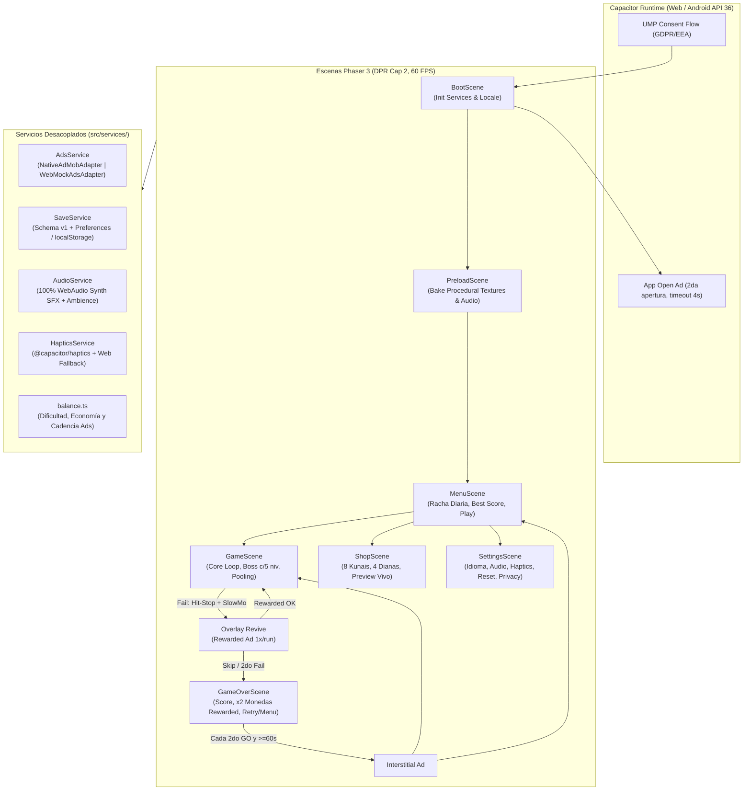

# Plan de Implementación — KUNAI RUSH (Android Hyper-Casual)

## Objetivo del Proyecto
Desarrollar **KUNAI RUSH**, un juego hyper-casual completo, pulido y listo para publicar en Google Play Store bajo temática original *Ninja Nocturno*, inspirado en la mecánica de lanzamiento de precisión rotacional (estilo *Knife Hit*), construido con **Phaser 3 + TypeScript + Vite + Capacitor** y monetizado con **Google AdMob** cumpliendo estrictamente las políticas de Google Play y AdMob (incluyendo consentimiento UMP GDPR/EEA y público objetivo 13+).

El proyecto será 100% autónomo (cero backend, cero cuentas de usuario, cero dependencias de assets externos en runtime) mediante **generación de arte procedural en Canvas/RenderTexture/SVG** y **síntesis de audio WebAudio**, con un `AdsService` dual que permite probar todos los flujos de monetización (Banner, Interstitial, Rewarded, App Open y Consentimiento UMP) directamente en el navegador mediante overlays DOM interactivos y telemetría de impresiones.

Además, el desarrollo seguirá una **estrategia de integración continua en GitHub (`kunai-rush`, repositorio público) con micro-commits y `git push` constantes** tras cada funcionalidad, servicio, escena o documento completado.

---

## (a) Investigación en GitHub y Verificación de Licencias y Requisitos

### 1. Verificación de candidatos conocidos (Sección 2 del Brief)

| Repositorio | Enlace | Licencia Verificada | Calidad / Estado | Qué reutilizaremos / Decisión |
| :--- | :--- | :--- | :--- | :--- |
| **phaserjs/examples** | [github.com/phaserjs/examples](https://github.com/phaserjs/examples) | **MIT** (solo código fuente) | Excelente (oficial Phaser 3) | **Solo patrones de código** (tweens, contenedores, partículas y `RenderTexture`). **ADVERTENCIA:** El propio repo advierte que los *assets* gráficos/sonoros incluidos provienen de juegos arcade clásicos o stock y **no** son aptos para uso comercial. No se usará ningún asset de este repo. |
| **gabrielecirulli/2048** | [github.com/gabrielecirulli/2048](https://github.com/gabrielecirulli/2048) | **MIT** | Muy buena (clásico web) | Patrón de persistencia limpia en `localStorage` con serialización segura de estado de partida y desbloqueo de input táctil/teclado con debounce. |
| **sourabhv/FlapPyBird** | [github.com/sourabhv/FlapPyBird](https://github.com/sourabhv/FlapPyBird) | **MIT** | Buena (Python/Pygame) | Referencia conceptual de loop arcade compacto (estados `Menu -> Play -> Crash -> GameOver`), pero al estar en Python/Pygame y contener sprites inspirados en Flappy Bird, no se reutiliza código ni assets. |
| **ellisonleao/clumsy-bird** | [github.com/ellisonleao/clumsy-bird](https://github.com/ellisonleao/clumsy-bird) | **MIT** ([LICENSE](https://github.com/ellisonleao/clumsy-bird/blob/master/LICENSE)) | Buena (MelonJS) | Estructura de estados web-first minimalista. No se reutilizan sus assets por similitud con Flappy Bird. |

### 2. Búsqueda de mecánicas ("knife hit phaser", "timberman", "stack tower", "kenney assets")

| Query / Repo | Enlace | Licencia | Evaluación y Qué Reutilizaremos |
| :--- | :--- | :--- | :--- |
| **`iagodahlem/knife-hit`** (*hocho*) | [github.com/iagodahlem/knife-hit](https://github.com/iagodahlem/knife-hit) | **MIT** (© Iago Dahlem) | **Hallazgo principal para la mecánica core.** Implementación en Phaser 3 de lanzamiento de cuchillos a un tronco rotatorio. Reutilizaremos (conservando el aviso de copyright MIT en `THIRD_PARTY_LICENSES.md` y en el módulo matemático) la **fórmula trigonométrica de colisión angular** (`Phaser.Math.Angle.ShortestBetween` entre el ángulo de impacto y los ángulos de objetos clavados en el contenedor rotatorio) y la cinemática de rebote al fallar. **Descartamos sus PNGs** por similitud visual con el juego original de Ketchapp. |
| **`phaserjs/template-vite-ts`** | [github.com/phaserjs/template-vite-ts](https://github.com/phaserjs/template-vite-ts) | **MIT** | Plantilla oficial de Phaser 3 + Vite + TypeScript. Base limpia para la configuración de `tsconfig.json`, `vite.config.ts` y ciclo de vida `Boot -> Preload -> Main`. |
| **`iamkun/tower_game`** (*Stack Tower*) | [github.com/iamkun/tower_game](https://github.com/iamkun/tower_game) | **MIT** | Referencia de curvas de dificultad progresiva por fórmula matemática y animaciones canvas fluidas a 60 fps en móvil. |
| **`GameDevHQ/Timber`** (*Timberman*) | [github.com/GameDevHQ/Timber](https://github.com/GameDevHQ/Timber) | **MIT** | Referencia de feedback visual de corte de madera (partículas direccionales, sacudida de cámara y barra/ritmo de presión). |
| **Kenney Assets / CC0** | [kenney.nl/assets](https://kenney.nl/assets) / [github.com/ETdoFresh/kenney.nl](https://github.com/ETdoFresh/kenney.nl) | **CC0 1.0 (Dominio Público)** | Referencia geométrica limpia para iconografía UI (candados, monedas, coronas, altavoz). Para garantizar **cero dependencias externas y estilo visual 100% cohesivo "Ninja Nocturno"**, generaremos todas las texturas en runtime con `ProceduralAssets.ts` (Phaser `Graphics` -> `generateTexture`) y audio con `WebAudio API`. |

### 3. Verificación del requisito de `targetSdk` en Google Play (`developer.android.com`)
- Según la política oficial vigente de Google Play (efectiva desde el **31 de agosto de 2026**), todas las **nuevas apps y actualizaciones** para teléfonos y tablets Android deben apuntar a **Android 16 (API level 36)** o superior (`compileSdk = 36`, `targetSdk = 36`).
- Configuraremos `variables.gradle` del proyecto Android con `compileSdkVersion = 36` y `targetSdkVersion = 36` (`minSdkVersion = 24`).

---

## Decisiones y Preflight Check Multi-PC en P0

> [!IMPORTANT]
> **Ejecución en otra PC — Paso `P0.0` (Verificación Individual Antes de Instalar):**
> Dado que ejecutarás el plan desde otra PC, el **primer paso de P0 (`P0.0`)** no instalará nada a ciegas. Ejecutará un chequeo individual de cada herramienta y ruta del sistema:
> 1. **Node.js y npm (`node -v`, `npm -v`):** Si ya están instalados (Node >= 18), se usan directamente; solo se instala Node.js LTS si no existe.
> 2. **Git (`git --version`, `git config user.name`, `git config user.email`):** Si ya está instalado, se usa directamente; solo se instala si falta.
> 3. **GitHub CLI (`gh --version`, `gh auth status`):** Se verifica si `gh` está instalado y si ya tiene sesión activa en GitHub. Solo se instala `gh` o se ejecuta `gh auth login` si no está disponible/autenticado.
> 4. **JDK (`java -version`, `javac -version`, `JAVA_HOME`) y Android SDK (`ANDROID_HOME`, `ANDROID_SDK_ROOT`, `%LOCALAPPDATA%\Android\Sdk`):** Se comprueba si esa PC cuenta con JDK 17/21+ y Android SDK. Si están presentes, en **P4** además de preparar `android/` ejecutaremos el build Gradle de verificación; si no están presentes en esa PC, se deja `npx cap add android` + `npx cap sync` 100% configurado y documentado según la Sección 9 del Brief.
> 5. **Repositorio Público (`kunai-rush`):** Se creará con visibilidad `--public` (`gh repo create kunai-rush --public --source=. --remote=origin --push`), lo que permite servir gratuitamente `privacy.html` y `app-ads.txt` mediante GitHub Pages.

---

## Estrategia de Git y GitHub: Micro-Commits y Push Continuo

Cada vez que completemos una unidad mínima funcional (un archivo de configuración, un servicio, una piscina de objetos, una escena, un adaptador de anuncios o un documento), ejecutaremos:
```powershell
git add <archivos>
git commit -m "<tipo>(<alcance>): <descripción concisa en inglés>"
git push origin main
```

### Mapa de los 26 Micro-Commits + Push Planificados

| # | Fase | Mensaje de Commit (Conventional Commits) | Qué incluye el Commit + Push |
| :-: | :-: | :--- | :--- |
| **C01** | P0 | `chore(init): scaffold vite typescript phaser project and gitignore` | `.gitignore` (excluyendo `keystore.properties`, `*.jks`, `node_modules`, `dist`), `package.json`, `tsconfig.json`, `vite.config.ts`, `index.html` |
| **C02** | P0 | `feat(config): add centralized game balance and difficulty formulas` | `src/config/balance.ts` con todas las curvas de nivel, giro, boss, economía y cadencia de ads |
| **C03** | P0 | `feat(config): add skins catalog, admob test ids and es/en i18n dictionary` | `src/config/skins.ts`, `src/config/adsConfig.ts`, `src/config/i18n.ts` |
| **C04** | P0 | `feat(save): implement versioned SaveService with preferences and localStorage fallback` | `src/services/SaveService.ts` (schema v1, migración, racha diaria, inventario, contadores de ads) |
| **C05** | P1 | `feat(art): add runtime procedural texture generator for kunais, targets and ui` | `src/objects/ProceduralAssets.ts` (8 kunais, 4 dianas, 3 dianas boss, coleccionables, partículas, grano/viñeta) |
| **C06** | P1 | `feat(scenes): implement BootScene and PreloadScene with texture baking` | `src/scenes/BootScene.ts`, `src/scenes/PreloadScene.ts`, `src/ui/UITheme.ts` |
| **C07** | P1 | `feat(gameplay): implement TargetWheel with delta-time rotation patterns` | `src/objects/TargetWheel.ts` (patrones nv 1–4 constante, 5+ aceleración, 10+ inversión, 15+ sinusoidal con tirón telegrafiado) |
| **C08** | P1 | `feat(gameplay): implement KunaiPool and CollectiblePool with angular collision math` | `src/objects/KunaiPool.ts`, `src/objects/CollectiblePool.ts` + validador de huecos mínimos anti-niveles-imposibles |
| **C09** | P1 | `feat(gameplay): implement core GameScene loop, 3-phase boss every 5 levels and input debounce` | `src/scenes/GameScene.ts` (lanzamiento, impacto, rebote en fallo, progresión de nivel, Boss cada 5 niveles, pausa por foco) |
| **C10** | P1 | `feat(scenes): add initial MenuScene and GameOverScene navigation flow` | `src/scenes/MenuScene.ts`, `src/scenes/GameOverScene.ts`, `src/main.ts` (MVP jugable de principio a fin) |
| **C11** | P2 | `feat(juice): add pooled wood/spark particles, target squash, hit-stop slow-mo and combo popups` | `src/objects/ParticleManager.ts` + integración de hit-stop, slow-mo 0.4s, screen shake y flash de nivel en `GameScene.ts` |
| **C12** | P2 | `feat(audio): implement 100% WebAudio synthesized sfx and ambient loop with first-tap unlock` | `src/services/AudioService.ts` (`throw`, `thunk`, `crack`, `clang`, `coin`, `combo`, `boss`, mute persistente) |
| **C13** | P2 | `feat(haptics): implement HapticsService wrapper for capacitor haptics with web fallback` | `src/services/HapticsService.ts` + disparo al clavar/fallar/romper diana |
| **C14** | P2 | `feat(meta): add daily login streak reward system and modal` | `src/ui/DailyStreakModal.ts` (días 1–4+: +10/+15/+25/+40 monedas, reinicio tras faltar un día) |
| **C15** | P2 | `feat(shop): implement ShopScene with live rotating preview for 8 kunais and 4 targets` | `src/scenes/ShopScene.ts` (compra, equipamiento persistente, preview en vivo, botón +25 monedas con cooldown 3m) |
| **C16** | P2 | `feat(settings): implement SettingsScene with locale switch, audio/haptics toggles and safe reset` | `src/scenes/SettingsScene.ts` (incluye modal de confirmación para borrar progreso y panel de contadores QA) |
| **C17** | P3 | `feat(ads): define IAdsService contract and AdsManager cadence rules` | `src/services/ads/IAdsService.ts`, `src/services/ads/AdsManager.ts` (cooldown 60s, cada 2º GO, skip primeros 2 GO) |
| **C18** | P3 | `feat(ads): implement NativeAdMobAdapter with UMP GDPR consent and non-personalized fallback` | `src/services/ads/NativeAdMobAdapter.ts` (`requestConsentInfo`, `showConsentForm`, Banner, Interstitial, Rewarded, App Open) |
| **C19** | P3 | `feat(ads): implement WebMockAdsAdapter with DOM overlays, 5s timers and QA impression telemetry` | `src/services/ads/WebMockAdsAdapter.ts` (simulación completa en navegador con opciones Reclamar y Cerrar sin recompensa) |
| **C20** | P3 | `feat(monetization): wire revive, x2 coins, free shop coins, safe-area banners and app open ad` | Conexión final de anuncios en `BootScene`, `MenuScene`, `GameScene` (Revive 1x/run), `GameOverScene` (x2 + Interstitial) y `ShopScene` |
| **C21** | P4 | `build(android): initialize capacitor android project targeting API 36 with signing config` | `capacitor.config.ts`, `android/` (`compileSdk=36`, `targetSdk=36`, `AD_ID` permission, AdMob App ID, `keystore.properties.example`) |
| **C22** | P4 | `art(store): generate 512x512 icon, adaptive icons and 1024x500 feature graphic from game art` | `scripts/generate-store-assets.mjs`, `public/store-assets/icon-512.png`, `public/store-assets/feature-1024x500.png`, iconos Android |
| **C23** | P4 | `docs(privacy): add bilingual ES/EN privacy.html and app-ads.txt for GitHub Pages` | `privacy.html`, `app-ads.txt`, `THIRD_PARTY_LICENSES.md` |
| **C24** | P4 | `docs(publishing): add comprehensive PUBLISHING.md Play Console checklist and README.md` | `PUBLISHING.md` (Data Safety, IARC 13+, 12 testers / 14 días, comandos `keytool` y AAB) y `README.md` |
| **C25** | P5 | `test(qa): add automated verification hooks and capture 360x800 store screenshots` | `public/store-assets/screenshots/` (capturas reales a `360×800` generadas en navegador) + ajustes finos de QA |
| **C26** | P5 | `chore(release): finalize v1.0.0 build and sync capacitor android` | Verificación final limpia de `npm run build` y `npx cap sync android` |

---

## (b) Arquitectura y Plan por Fases (P0 a P5)

### Diagrama de Arquitectura y Flujo de Escenas / Servicios



### Árbol de Archivos Propuesto

```text
kunai-rush/                           # En el workspace activo o <appDataDir>/scratch/kunai-rush
├── .git/                             # Repositorio Git sincronizado con GitHub (origin/main)
├── .gitignore                        # Ignora node_modules, dist, keystore.properties, *.jks, *.keystore
├── index.html                        # Viewport meta (safe-area, user-scalable=no), contenedor #app y #ads-overlay
├── package.json                      # Phaser 3, Vite, TS, @capacitor/core, @capacitor/cli, @capacitor/android, plugins
├── tsconfig.json                     # TypeScript estricto (strict: true, noUnusedLocals: true)
├── vite.config.ts                    # Build optimizado con base './' para Capacitor WebView
├── capacitor.config.ts               # appId: 'com.tuestudio.kunairush', appName: 'Kunai Rush', portrait/fullscreen
├── keystore.properties.example       # Plantilla para firma de release AAB (keystore.properties en .gitignore)
├── privacy.html                      # Política de privacidad bilingüe (ES/EN) lista para GitHub Pages
├── app-ads.txt                       # Plantilla oficial IAB para vincular dominio de desarrollador con AdMob
├── README.md                         # Guía rápida de desarrollo, arquitectura, cambio de IDs y build
├── PUBLISHING.md                     # Checklist exhaustivo de Google Play Console (API 36, Data Safety, 12 testers, AAB)
├── THIRD_PARTY_LICENSES.md           # Avisos de licencia MIT (Phaser 3, Capacitor, algoritmo angular iagodahlem/knife-hit)
├── public/
│   └── store-assets/                 # Assets generados para Play Store (icon-512.png, feature-1024x500.png, screenshots/)
├── scripts/
│   └── generate-store-assets.mjs     # Script para exportar SVG/PNG de icono 512x512 y feature graphic 1024x500
├── android/                          # Proyecto nativo Android generado por Capacitor y configurado a API 36
│   ├── variables.gradle              # minSdkVersion=24, compileSdkVersion=36, targetSdkVersion=36
│   └── app/
│       ├── build.gradle              # Configuración de signingConfigs (release desde keystore.properties)
│       └── src/main/AndroidManifest.xml # screenOrientation="portrait", permiso AD_ID, AdMob APPLICATION_ID
└── src/
    ├── main.ts                       # Bootstrap de Phaser 3, gestión de resize/safe-area, visibilitychange y App state
    ├── config/
    │   ├── balance.ts                # ÚNICA fuente de verdad: dificultad, rotación, jefes, economía, cadencia de ads
    │   ├── adsConfig.ts              # Test IDs oficiales de AdMob + flag de entorno y configuración UMP
    │   ├── skins.ts                  # Definición visual y precios de los 8 kunais y 4 dianas + 3 dianas de Boss
    │   └── i18n.ts                   # Diccionario completo ES/EN con detección automática por locale y cambio en vivo
    ├── services/
    │   ├── SaveService.ts            # Persistencia versionada (schemaVersion: 1), racha diaria, inventario, telemetría ads
    │   ├── AudioService.ts           # Sintetizador WebAudio (throw, thunk, crack, coin, combo, fail, boss, BGM loop)
    │   ├── HapticsService.ts         # Wrapper de @capacitor/haptics (impact light/medium/heavy, notification error)
    │   └── ads/
    │       ├── IAdsService.ts        # Interfaz común y tipos de eventos/telemetría de anuncios
    │       ├── AdsManager.ts         # Orquestador con reglas de cadencia (cooldown 60s, skip primeros 2 GO, cada 2do GO)
    │       ├── NativeAdMobAdapter.ts # Implementación real con @capacitor-community/admob + UMP Consent
    │       └── WebMockAdsAdapter.ts  # Overlay DOM para navegador (Banner safe-area, Interstitial 5s, Rewarded 5s, AppOpen 4s)
    ├── objects/
    │   ├── ProceduralAssets.ts       # Generador runtime (bake una sola vez en Preload) de todas las texturas del juego
    │   ├── TargetWheel.ts            # Diana/tronco central, evaluación de patrones de giro con delta time y squash/stretch
    │   ├── KunaiPool.ts              # Object Pool de kunais (en vuelo, clavados y rebotados) sin allocations por frame
    │   ├── CollectiblePool.ts        # Object Pool de coleccionables (manzanas/monedas ninja) en el perímetro de la diana
    │   └── ParticleManager.ts        # Emisores reutilizables (astillas de madera, chispas de colisión, explosión de boss)
    ├── ui/
    │   ├── UITheme.ts                # Paleta "Ninja Nocturno", helpers de botones animados, modales y grano/viñeta
    │   └── DailyStreakModal.ts       # Popup de recompensa por racha diaria (días 1 a 4+)
    └── scenes/
        ├── BootScene.ts              # Inicializa SaveService, i18n, StatusBar, UMP Consent y App Open Ad (si apertura >= 2)
        ├── PreloadScene.ts           # Genera todas las texturas procedurales y pre-calcula buffers de WebAudio
        ├── MenuScene.ts              # Título, mejor nivel/puntuación, racha diaria, acceso a Jugar/Tienda/Ajustes + Banner
        ├── GameScene.ts              # Core gameplay loop, HUD de kunais restantes/nivel/monedas, Boss 3 fases, Revive modal
        ├── GameOverScene.ts          # Resumen de partida, botón x2 monedas (Rewarded), Reintentar/Menú + Interstitial + Banner
        ├── ShopScene.ts              # Preview rotatorio en vivo, 8 kunais, 4 dianas, botón +25 monedas gratis (cooldown 3m)
        └── SettingsScene.ts          # Toggles de Audio/Haptics/Idioma, visor de contadores QA de Ads, Reset con confirmación
```

---

### Desglose Detallado por Fases y Estimación

#### Fase P0 — Preflight Check Multi-PC, GitHub Repo e Infraestructura Base (~25 min)
1. **Preflight Check Individual (`P0.0`):**
   - Comprobar uno por uno en la PC donde se ejecute el plan: `node`, `npm`, `git`, `gh` (y `gh auth status`), `java`/`javac` (JDK 17/21+) y `ANDROID_HOME` / `ANDROID_SDK_ROOT` (incluyendo `%LOCALAPPDATA%\Android\Sdk`).
   - Instalar **únicamente** lo que falte (por ejemplo, vía `winget` si falta `node`, `git` o `gh`) y reutilizar sin tocar todo lo que ya esté instalado en esa PC.
2. **Repositorio GitHub Público (`P0.1`):**
   - Creación del directorio del proyecto, `git init -b main`, creación del repositorio público en GitHub (`gh repo create kunai-rush --public --source=. --remote=origin`) y primer push (**C01**).
3. **Dependencias:** Instalación de `phaser`, `vite`, `typescript`, `@capacitor/core`, `@capacitor/cli`, `@capacitor/android`, `@capacitor-community/admob`, `@capacitor/preferences`, `@capacitor/haptics`, `@capacitor/status-bar`, `@capacitor/app`.
4. **Configuración central (`balance.ts`, `adsConfig.ts`, `skins.ts`, `i18n.ts`, `SaveService.ts`):**
   - `balance.ts` (**C02**), catálogos y diccionarios (**C03**) y `SaveService.ts` (**C04**), haciendo `git commit` + `git push` tras cada uno.

---

#### Fase P1 — Core Loop Jugable (MVP) (~35 min)
1. **Generador de Arte Procedural (`ProceduralAssets.ts`) (**C05**) y `Boot`/`Preload` (**C06**):**
   - Generación una sola vez en `PreloadScene` de texturas nítidas (DPR cap 2): los 8 diseños de kunai, las 4 dianas normales, las 3 dianas especiales de Boss, coleccionables (moneda/manzana dorada), iconos de UI, textura de grano sutil y viñeta nocturna.
2. **Física Angular y Patrones de Giro (`TargetWheel.ts`) (**C07**):**
   - Niveles 1–4: velocidad angular constante.
   - Niveles 5+: ondas de aceleración suaves.
   - Niveles 10+: paradas breves e inversiones de sentido.
   - Niveles 15+: movimiento sinusoidal combinado con tirones rápidos precedidos por un destello ámbar telegrafiado en el borde de la diana.
3. **Pools y Generación de Niveles Imposibles = Cero (**C08**):**
   - Algoritmo de colocación de kunais pre-clavados (0 a 3 según nivel) y coleccionables (1 a 3) sobre una rejilla angular discreta que garantiza al menos `minFreeArcDeg` (`28°`) de hueco libre para que todos los kunais del nivel tengan espacio físico válido.
4. **Colisión, Boss (cada 5 niveles) y Escenas Base (`GameScene.ts`, `MenuScene.ts`, `GameOverScene.ts`) (**C09, C10**):**
   - Un tap = un lanzamiento con debounce (`throwCooldownMs = 110 ms`).
   - Al llegar al radio de la diana: comprueba distancia angular (`Phaser.Math.Angle.ShortestBetween`) contra los kunais ya clavados.
   - Si choca (`< minCollisionAngleDeg`): activa fallo (rebote físico con rotación, hit-stop 80 ms, slow-mo 0.4 s y shake).
   - Si acierta: se ancla al ángulo actual de la diana; comprueba corte de coleccionables; si es el último kunai del nivel, la diana estalla y avanza al siguiente nivel.
   - **Boss cada 5 niveles:** 3 fases consecutivas (al 100%, 66% y 33% de kunais restantes cambia de patrón de giro y emite pulso visual), otorgando **+15 monedas** al derrotarlo.
5. **Verificación en navegador de P1:** Comprobar lanzamiento, colisión, paso de nivel, Boss en nivel 5 y pantalla de Game Over.

---

#### Fase P2 — Juice, Audio Sintetizado, Haptics, Meta y Tienda (~35 min)
1. **Dirección de Arte "Ninja Nocturno" y Juice (**C11**):**
   - Paleta: fondo `#0c0e1d` (índigo profundo), acentos `#e63946` (rojo bermellón) y `#ffb703` (ámbar), éxito `#2ec4b6` (verde jade), info `#00b4d8` (cian).
   - Partículas con pooling: astillas al clavar, chispas rojas/ámbar al chocar metal con metal, explosión radial al romper la diana.
   - Squash & stretch de la diana en cada impacto, popups flotantes de combo (`COMBO x2`, `x3`...) y flash jade de nivel completado.
2. **Audio 100% WebAudio (`AudioService.ts`) (**C12**) y `HapticsService.ts` (**C13**):**
   - Síntesis en tiempo real para: `throw`, `thunk`, `crack`, `clang`, `coin`, `combo` y `boss`, más loop ambiental ninja procedural opcional.
   - Desbloqueo automático de `AudioContext` en el primer `pointerdown` y botón de mute persistente.
3. **Economía, Racha Diaria (**C14**), Tienda (`ShopScene.ts`) (**C15**) y Ajustes (`SettingsScene.ts`) (**C16**):**
   - Racha diaria automática en `MenuScene` (+10 / +15 / +25 / +40 monedas en días 1–4+, reinicio si faltas un día).
   - `ShopScene` con pestañas **Kunais (8 skins, 50–500 monedas)** y **Dianas (4 skins, 100–800 monedas)**, previsualización en vivo de la diana girando con el kunai equipado, compra/equipamiento persistente y botón "+25 Monedas Gratis" con temporizador de cooldown de 3 min.
   - `SettingsScene` con selector ES/EN en vivo, toggles de Audio y Haptics, y botón "Borrar Progreso" con modal de confirmación.
4. **Verificación en navegador de P2:** Probar tienda, compra/equipamiento de skins, racha diaria, audio/mute y ajustes.

---

#### Fase P3 — Monetización AdMob + Mock Web Completo + Consentimiento UMP (~30 min)
1. **Interfaz Única y `AdsManager.ts` (**C17**) + `NativeAdMobAdapter.ts` (**C18**):**
   - Gestión de consentimiento **UMP (GDPR/EEA)** al arrancar (`requestConsentInfo` -> `showConsentForm` si aplica); si no hay consentimiento, todas las solicitudes de anuncios llevan `npa: true`.
   - **Banner:** visible únicamente en `MenuScene`, `ShopScene` y `GameOverScene`, anclado en la parte inferior respetando `env(safe-area-inset-bottom)` y reservando margen inferior de UI (`72px`) para que ningún botón quede cerca del anuncio. Oculto inmediatamente al entrar en `GameScene` o `SettingsScene`.
   - **Interstitial:** evaluado solo al pulsar "Reintentar" o "Menú" en `GameOverScene`. Condición estricta:
     `sessionGameOvers > 2 && (sessionGameOvers % 2 === 1) && (now - lastInterstitialTime >= 60_000)`.
   - **Rewarded:**
     1. *Revive:* 1 vez por partida al fallar; continúa exactamente en el mismo nivel y fase con los kunais ya clavados intactos.
     2. *x2 Monedas:* 1 vez al final de la partida en `GameOverScene`, duplicando las monedas ganadas en esa run.
     3. *+25 Monedas Gratis:* en `ShopScene`, con cooldown persistente de 180 segundos.
   - **App Open Ad:** solo en arranque en frío a partir de `appLaunchCount >= 2`, con timeout máximo de 4 segundos y fallback inmediato a `MenuScene`.
2. **`WebMockAdsAdapter.ts` (**C19**) e Integración en Escenas (**C20**):**
   - Overlays DOM estilizados que simulan fielmente AdMob (Banner safe-area, Interstitial 5 s + cerrar, Rewarded 5 s + "Reclamar recompensa" / "Cerrar sin recompensa", App Open 4 s).
   - Historial/contadores de impresiones accesibles en `window.__KUNAI_QA__` y en el panel de diagnóstico de `SettingsScene`.
3. **Verificación en navegador de P3:** Probar los 4 formatos de anuncios, el flujo sin recompensa, el cooldown de 60s y la regla de los 2 primeros game overs.

---

#### Fase P4 — Empaquetado Android (API 36), Assets de Store y Documentación (~25 min)
1. **Sincronización Capacitor Android (`npx cap add android`, `npx cap sync`) (**C21**):**
   - Configuración de `android/variables.gradle` con `compileSdkVersion = 36` y `targetSdkVersion = 36`.
   - Configuración de `AndroidManifest.xml` con `android:screenOrientation="portrait"`, permiso `com.google.android.gms.permission.AD_ID` y `com.google.android.gms.ads.APPLICATION_ID` de test.
   - Configuración de `android/app/build.gradle` para leer `keystore.properties` en el bloque `signingConfigs.release`.
   - Si el chequeo `P0.0` detectó JDK 21 + Android SDK en la PC de ejecución, se ejecutará además la compilación de verificación con Gradle; si no, quedará 100% sincronizado y documentado.
2. **Assets de Store (**C22**) y Documentación Legal/Publicación (**C23, C24**):**
   - Generación de `public/store-assets/icon-512.png`, `feature-graphic-1024x500.png` e iconos adaptativos Android.
   - `privacy.html` bilingüe (ES/EN) lista para GitHub Pages, `app-ads.txt`, `THIRD_PARTY_LICENSES.md`, `PUBLISHING.md` y `README.md`.

---

#### Fase P5 — QA Obligatorio End-to-End en Navegador (~25 min)
Ejecución del plan de pruebas de la **Sección 10** con el agente de navegador, commit/push de las capturas `360×800` para la ficha de Google Play (**C25**) y commit/push de cierre de release (**C26**), documentando todas las evidencias en `walkthrough.md`.

---

## (c) Lista de Tareas Accionables (Checklist con Commits + Push)

- [ ] **P0.0** Ejecutar **Preflight Check** individual en la PC de ejecución (`node`, `npm`, `git`, `gh`, `gh auth status`, `java`/`javac`, `ANDROID_HOME`/`ANDROID_SDK_ROOT`) e instalar únicamente las herramientas que no estén presentes.
- [ ] **P0.1** Inicializar el proyecto y repositorio local (`git init -b main`), crear el repositorio público `kunai-rush` en GitHub (`gh repo create kunai-rush --public --source=. --remote=origin`) y hacer push del scaffold inicial (**Commit C01 + Push**).
- [ ] **P0.2** Implementar `src/config/balance.ts` con todas las fórmulas de dificultad, economía y cadencia de anuncios (**Commit C02 + Push**).
- [ ] **P0.3** Implementar `src/config/skins.ts`, `src/config/adsConfig.ts` (IDs oficiales de test AdMob) y `src/config/i18n.ts` (ES/EN) (**Commit C03 + Push**).
- [ ] **P0.4** Implementar `src/services/SaveService.ts` con esquema versionado v1, migración, racha diaria y contadores de anuncios (**Commit C04 + Push**).
- [ ] **P1.1** Implementar `src/objects/ProceduralAssets.ts` (8 kunais, 4 dianas normales, 3 dianas Boss, coleccionables, partículas e iconos UI) (**Commit C05 + Push**).
- [ ] **P1.2** Implementar `BootScene.ts`, `PreloadScene.ts` y `UITheme.ts` (**Commit C06 + Push**).
- [ ] **P1.3** Implementar `TargetWheel.ts` con rotación basada en `delta` time y los 4 patrones de movimiento por nivel (**Commit C07 + Push**).
- [ ] **P1.4** Implementar `KunaiPool.ts` y `CollectiblePool.ts` con colisión angular exacta y validación de ángulos mínimos para evitar niveles imposibles (**Commit C08 + Push**).
- [ ] **P1.5** Implementar `GameScene.ts` con loop principal, Boss de 3 fases cada 5 niveles, debounce anti-spam y pausa automática al perder foco (**Commit C09 + Push**).
- [ ] **P1.6** Implementar `MenuScene.ts`, `GameOverScene.ts` y `main.ts`, y verificar MVP jugable (P1) en navegador (**Commit C10 + Push**).
- [ ] **P2.1** Implementar `ParticleManager.ts` y efectos de juice (astillas, chispas, squash del tronco, hit-stop + slow-mo 0.4s + shake, popups de combo, flash de nivel) (**Commit C11 + Push**).
- [ ] **P2.2** Implementar `AudioService.ts` con efectos sintetizados WebAudio, loop opcional, mute persistente y desbloqueo en primer tap (**Commit C12 + Push**).
- [ ] **P2.3** Implementar `HapticsService.ts` con `@capacitor/haptics` y fallback en web (**Commit C13 + Push**).
- [ ] **P2.4** Implementar sistema y modal de racha diaria (`DailyStreakModal.ts`: +10/+15/+25/+40 monedas) (**Commit C14 + Push**).
- [ ] **P2.5** Implementar `ShopScene.ts` (8 kunais + 4 dianas con preview rotatorio en vivo y botón +25 monedas gratis con cooldown de 3 min) (**Commit C15 + Push**).
- [ ] **P2.6** Implementar `SettingsScene.ts` (idioma ES/EN, sonido, haptics, visor QA de anuncios y reset de progreso con confirmación) y verificar P2 en navegador (**Commit C16 + Push**).
- [ ] **P3.1** Implementar `IAdsService.ts` y `AdsManager.ts` con las reglas estrictas de cadencia (**Commit C17 + Push**).
- [ ] **P3.2** Implementar `NativeAdMobAdapter.ts` con flujo de consentimiento UMP (GDPR/EEA) y degradación a anuncios no personalizados (**Commit C18 + Push**).
- [ ] **P3.3** Implementar `WebMockAdsAdapter.ts` con overlays DOM interactivos (Banner safe-area, Interstitial 5s, Rewarded 5s con reclamar/cerrar sin recompensa, App Open 4s) (**Commit C19 + Push**).
- [ ] **P3.4** Conectar todos los flujos de anuncios en las escenas (Revive 1x, x2 Monedas, Monedas Gratis en Tienda, Interstitial tras Game Over, Banner y App Open) y verificar P3 en navegador (**Commit C20 + Push**).
- [ ] **P4.1** Configurar `capacitor.config.ts`, ejecutar `npx cap add android` y `npx cap sync`, y ajustar `variables.gradle` (`compileSdk=36`, `targetSdk=36`), `AndroidManifest.xml` y `build.gradle` (**Commit C21 + Push**).
- [ ] **P4.2** Generar y commitear los assets de Play Store (`icon-512.png`, `feature-1024x500.png` e iconos adaptativos Android) (**Commit C22 + Push**).
- [ ] **P4.3** Redactar y commitear `privacy.html` (ES/EN), `app-ads.txt` y `THIRD_PARTY_LICENSES.md` (**Commit C23 + Push**).
- [ ] **P4.4** Redactar y commitear `PUBLISHING.md` y `README.md` (**Commit C24 + Push**).
- [ ] **P5.1** Ejecutar QA completo en navegador (Sección 10), generar capturas `360×800` para Play Store y hacer push de assets/ajustes (**Commit C25 + Push**).
- [ ] **P5.2** Ejecutar `npm run build` y `npx cap sync android` finales, hacer push del cierre v1.0.0 (**Commit C26 + Push**) y entregar reporte `walkthrough.md`.

---

## (d) Riesgos y Mitigaciones

| Categoría | Riesgo Identificado | Impacto | Estrategia de Mitigación en el Plan |
| :--- | :--- | :--- | :--- |
| **1. Licencias y Propiedad Intelectual** | Uso accidental de sprites o sonidos con licencias no comerciales (ej. los assets de `phaserjs/examples` o clones en GitHub con sprites ripeados de Ketchapp/Voodoo) que provocarían rechazo o suspensión en Google Play. | Crítico | **Cero assets externos de terceros.** Todo el arte (8 kunais, 4 dianas + 3 bosses, partículas, UI) se genera proceduralmente en `ProceduralAssets.ts` y todos los efectos de sonido se sintetizan con WebAudio en `AudioService.ts`. Del código MIT de referencia solo se toma el enfoque trigonométrico angular con su aviso en `THIRD_PARTY_LICENSES.md`. |
| **2. Políticas de AdMob y Google Play (Clics accidentales y Privacidad)** | Rechazo de la app o limitación de anuncios en AdMob por colocar banners cerca de áreas de juego, lanzar interstitials por sorpresa durante la partida o al salir, o no solicitar consentimiento UMP en la UE/Reino Unido. | Crítico | **Cumplimiento por diseño:** (1) El Banner se destruye/oculta al entrar en `GameScene` y en las escenas donde aparece (`Menu`, `Shop`, `GameOver`) se reserva un área segura (`safe-area-inset-bottom + 72px`) separada de los botones; (2) Los Interstitials solo saltan tras una acción explícita del usuario ("Reintentar" o "Menú" en Game Over), nunca en los 2 primeros Game Overs y con >=60s de enfriamiento; (3) Flujo UMP ejecutado antes de inicializar anuncios; (4) Público objetivo 13+ e inclusión de `com.google.android.gms.permission.AD_ID` y `privacy.html`. |
| **3. Rendimiento en Android Gama Media (GC pauses / caída de FPS)** | Instanciar y destruir objetos `Phaser.GameObjects` o texturas en cada lanzamiento de kunai o explosión de partículas causa tirones por Garbage Collection en WebView móvil. | Alto | (1) `ProceduralAssets.ts` hornea (`generateTexture`) todas las texturas una única vez en `PreloadScene`; (2) `KunaiPool`, `CollectiblePool` y `ParticleManager` pre-alojan instancias reutilizables (0 allocations por frame); (3) `devicePixelRatio` limitado a máximo `2`; (4) Toda la rotación y movimiento usa `delta` time. |
| **4. Niveles Imposibles en Generación Infinita** | En niveles altos con hasta 3 kunais pre-clavados y 10 kunais por lanzar, una colocación aleatoria pura podría dejar huecos demasiado estrechos, haciendo el nivel matemáticamente imposible. | Medio | División del perímetro de la diana en sectores angulares discretos (`24` slots de `15°`). Los obstáculos pre-clavados y coleccionables se asignan verificando que queden suficientes slots libres con margen de seguridad (`>= 24°` por kunai) antes de iniciar el nivel. |
| **5. Diferencias de Entorno entre PCs (ejecución en otra PC)** | La PC donde se ejecute el plan puede tener ya instaladas algunas herramientas (`node`, `git`, `gh`, `JDK 21`, `Android SDK`) o carecer de alguna de ellas. | Medio | El paso **`P0.0` (Preflight Check)** verifica individualmente cada binario y variable de entorno antes de tocar nada: reutiliza lo que ya esté instalado, instala solo lo que falte, y adapta P4 para compilar directamente con Gradle si detecta JDK + Android SDK en esa PC. |
| **6. Exposición accidental de claves de firma en GitHub** | Con un flujo de commits y push frecuentes en un repositorio público, existe el riesgo de subir accidentalmente `keystore.properties` o archivos `.jks`/`.keystore`. | Crítico | Desde el **Commit C01**, `.gitignore` bloqueará explícitamente `keystore.properties`, `*.jks`, `*.keystore`, `.env*` y `local.properties`, subiendo únicamente `keystore.properties.example` con placeholders seguros. |

---

## Verificación Planificada

### Comandos Automatizados (al ejecutar el plan)
```powershell
npm run typecheck
npm run build
npx cap sync android
git status # Verificar working tree limpio y sincronizado con origin/main
```

### Verificación Interactiva con el Agente de Navegador
- Al finalizar **P1, P2, P3 y P5**, se levantará el servidor de desarrollo Vite y el agente de navegador verificará visual y funcionalmente cada requisito de la Sección 10 (incluyendo capturas en `360×800`, `390×844` y escritorio).
